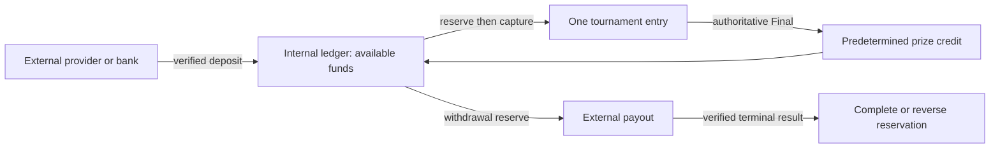

# Fugluck — full project handoff

**Original inventory: 2026-10-12. Technical stabilization update: 2026-10-22 (Asia/Tbilisi). Repository: C:\Users\abuse\Fugluck.**

This is a repository-based discovery report, not commercial approval. It describes the current checkout, identifies historical evidence explicitly, and records the missing inputs needed for launch. Another developer can start here without reading the conversation.

**Current conclusion (2026-10-22):** local technical stabilization is COMPLETE: all 55 regression scripts / 2,409 assertions, all relevant builds, isolated migrations and clean-install checks passed; dependency audits report zero findings. Staging acceptance remains PARTIAL; read-only health and client/server parity passed on a 32.6-second retry after an initial timeout. Production isolation and commercial launch are not accepted. The local changes are uncommitted and not deployed; main HEAD is unchanged.

## 2026-10-22 stabilization update

**BUILT / verified by fresh command execution and source review.** Read [the full stabilization report](TECHNICAL_STABILIZATION_REPORT.md) and [sanitized evidence](evidence/technical-stabilization-20261022.json) for every script count, changed path, command, dependency disposition, failed attempt and limitation.

- Final complete regression: **55 scripts, 2,409 passes, 0 failures, 0 unsuccessful exits, no skips**, at source fingerprint **b5c5cac536b7145529a60060d0d9f45771fe278a328bf634c48d9ce6122cc59f**. DB-independent subset **27/907**; database-writing subset **28/1,502**. New tests add 57 assertions; no historical assertion reduction. The original 25/850 baseline was reproduced before edits.
- **BUILT fixes:** proxy-addr 2.0.8, source-map-js 1.2.2, Vite 8.1.6, narrow old-esbuild override to 0.25.12; TypeScript 5.9.3 peer compatibility and npm 11.21.1 expectation; canonical viewport in three ResizeObservers; routing-override rejection in the test DB guard; empty queue-bucket cleanup; guarded complete regression runner. Full/production audits and dependency tree exit 0.
- All workspace/new-tooling type checks, optimized client build, server noEmit gate and an isolated clean-install build passed. Existing **17 lint warnings** and **731.97 kB main chunk warning** remain. No compiler/security/gameplay gate was relaxed.
- Both new local databases were created empty from template0 in a verified loopback PostgreSQL 17.11 cluster. Full migrations **15/15**, head **0014_security_boundaries**, **41 public tables**; schema parity **338/338**. No hosted DB write or saved environment change.
- Local browser checked Space Blaster, Cyber Hopper and Speed Trivia launch/input/exit; integrated HTTP/session/socket/money-disabled/deep-link smoke **19/19**, counted separately. An overlapping validation attempt hit SERVER_TICK_LAG and failed one authority script; final serial rerun with app/browser/build work stopped passed all 55. Keep the failure evidence; capacity under competing load is not certified.
- Staging frontend metadata GET **200**, revision **3a24ea02df7dc9bfa4d06d4d19d13439ae517073**, commercialMoneyEnabled=false. API health first timed out at 15 seconds, then a bounded retry returned **200 after 32.6 seconds**, confirming healthy DB, matching migrations, the same SHA and all real-money actions disabled. Mock competitions enabled; mock deposits/withdrawals disabled. Hosted security **87/87** and earlier gameplay remain historical. New changes have not been deployed.
- **PLANNED / outside this session:** separately authorized staging release and full hosted 8/16/qualification/recovery/security acceptance; Production isolation; real email; IAM/CSP/admin operational controls; monitoring/DR/capacity; legal/KYC/tax/provider approvals and Keepz integration. Real money remains hard-disabled in source and local tests.
- Git mutation commands, commits, pushes, PRs, deployments, Production access, hosted writes, external messages and payment activation: **NONE**. Pre-existing AGENTS/.agents/prior inventory/diagnostic work, deployment guards and exclusions were preserved. Requested handoff/progress edits are additive.

The remaining inventory retains its original October 12 observations unless explicitly updated below. In untouched historical passages, “VERIFIED NOW” and “fresh” refer to **October 12**, not October 22. Historical dates/counts are retained deliberately; this update and the final status card state the current local baseline.

## Evidence and boundaries — original October 12 inventory

- **BUILT / source-read** means implementation was inspected in this checkout. It does not mean externally certified, commercially approved, or freshly exercised end to end.
- **VERIFIED NOW** means a command/check or read-only HTTPS observation was performed on October 12. **HISTORICAL VERIFIED** means a dated repository evidence file records the observation; it was not repeated.
- **PLANNED** means a design, requested direction, or outstanding task, not implementation. **UNKNOWN / UNVERIFIED** means no sufficient evidence was found.
- Current main: **3dea8a10bab04b56b22efd5e3084532beb7125bd**. Accepted feature/staging: **3a24ea02df7dc9bfa4d06d4d19d13439ae517073**.
- Fresh verification: **25 scripts, 850 passing assertions, 0 failures**. The other **28 scripts write PostgreSQL**, and the configured test destination is remote. They were not run under this task's read-only/no-environment-change restriction. Every script's fresh or historical count is in section 40.
- Last recorded full regression: **53 scripts / 2,352 assertions / 0 failures**, October 2. Last recorded hosted security acceptance: **42 general + 45 proxy = 87/87**, October 1; later handoff records retain this accepted feature baseline. Neither is presented as a fresh full run.
- Current staging HTTPS observations: frontend deployment identity, API readiness, home/robots/sitemap only. No authenticated hosted action, database write, registration, competition entry, payment, deployment, or Production access occurred.
- Existing uncommitted local files were preserved. Output consists of this document, sanitized [inventory evidence](evidence/full-project-inventory-20261012.json), and a new PROGRESS entry. Source, lockfile, deployment configuration and environment files were not changed.
- The user explicitly confirmed that missing Keepz details should be marked unverified. The request supplies planning topics, not evidence that a Keepz API, approval, tax treatment, bot policy, or rebrand already exists.
- JevRouter selected repository inspection as the primary capability. Public advisory checks supplement local npm audit findings.

Older AGENTS/PROGRESS assertions about Supabase browser auth, active Diamonds, six tests, four games, replay adapters, or a pending main merge are superseded by inspected code and the facts here. Preserve historical evidence; do not implement against those obsolete claims.

## Table of contents

- [1. Basic project identity](#1-basic-project-identity)
- [2. Languages](#2-languages)
- [3. Frameworks and major libraries](#3-frameworks-and-major-libraries)
- [4. Repository structure](#4-repository-structure)
- [5. Frontend architecture](#5-frontend-architecture)
- [6. Backend architecture](#6-backend-architecture)
- [7. Database architecture](#7-database-architecture)
- [8. Authentication](#8-authentication)
- [9. Authorization](#9-authorization)
- [10. Security state](#10-security-state)
- [11. Trusted proxy and rate limiting](#11-trusted-proxy-and-rate-limiting)
- [12. Competition product model](#12-competition-product-model)
- [13. Tournament engine](#13-tournament-engine)
- [14. Standard competition economics](#14-standard-competition-economics)
- [15. Promo competitions](#15-promo-competitions)
- [16. Gift competitions](#16-gift-competitions)
- [17. Qualification engine](#17-qualification-engine)
- [18. Server-authoritative game model](#18-server-authoritative-game-model)
- [19. Current games](#19-current-games)
- [20. Wallet architecture](#20-wallet-architecture)
- [21. Ledger and accounting](#21-ledger-and-accounting)
- [22. Deposit flow](#22-deposit-flow)
- [23. Withdrawal flow](#23-withdrawal-flow)
- [24. Refund flow](#24-refund-flow)
- [25. Payment provider strategy](#25-payment-provider-strategy)
- [26. Keepz technical review](#26-keepz-technical-review)
- [27. Keepz security concerns](#27-keepz-security-concerns)
- [28. Keepz business and KYC blockers](#28-keepz-business-and-kyc-blockers)
- [29. Currency model](#29-currency-model)
- [30. Foreign players](#30-foreign-players)
- [31. Bots](#31-bots)
- [32. Tax and VAT](#32-tax-and-vat)
- [33. Business scale and unit economics](#33-business-scale-and-unit-economics)
- [34. Infrastructure](#34-infrastructure)
- [35. Staging](#35-staging)
- [36. Production](#36-production)
- [37. Auto-deploy and main safety](#37-auto-deploy-and-main-safety)
- [38. Git history and branch status](#38-git-history-and-branch-status)
- [39. Migrations](#39-migrations)
- [40. Testing architecture](#40-testing-architecture)
- [41. Backups and disaster recovery](#41-backups-and-disaster-recovery)
- [42. Logging and monitoring](#42-logging-and-monitoring)
- [43. Email](#43-email)
- [44. Admin system](#44-admin-system)
- [45. Environment variable inventory](#45-environment-variable-inventory)
- [46. SEO and Google](#46-seo-and-google)
- [47. Branding](#47-branding)
- [48. Legal and KYC readiness](#48-legal-and-kyc-readiness)
- [49. Diamonds and Coins history](#49-diamonds-and-coins-history)
- [50. Public website content](#50-public-website-content)
- [51. Current blockers](#51-current-blockers)
- [52. What is already complete](#52-what-is-already-complete)
- [53. TODO from now to commercial launch](#53-todo-from-now-to-commercial-launch)
- [54. What should not be built now](#54-what-should-not-be-built-now)
- [55. Executive summary](#55-executive-summary)
- [56. Handoff document and how to continue](#56-handoff-document-and-how-to-continue)
- [57. Final status card](#57-final-status-card)

## 1. Basic project identity

**BUILT / verified by package files and Git commands.** Brand and root package name are Fugluck; prior ArcadeClash naming remains in identifiers. The repository is an npm workspace monorepo, root version 0.0.1, private, with packages under packages/* and games. It uses package-lock.json. **October 22 BUILT:** packageManager npm@11.21.1, engines Node >=22.12.0 and npm >=11.21.1 <12, verified in the updated root manifest and clean install. No Yarn/pnpm lock is used.

| Item | Verified value |
|---|---|
| Checkout | C:\Users\abuse\Fugluck |
| Current branch / upstream | main / origin/main |
| HEAD, local main, cached origin/main and live remote main | 3dea8a10bab04b56b22efd5e3084532beb7125bd |
| Main ahead/behind origin/main | 0 / 0 |
| Feature branch, local and live remote | codex/competition-restructure at 3a24ea02df7dc9bfa4d06d4d19d13439ae517073 |
| Main relative to feature | 2 ahead / 0 behind; feature already incorporated |
| Primary remote | [abuseridzerati-max/fugluck](https://github.com/abuseridzerati-max/fugluck) |
| Secondary remote | gigondziii → [Gigondziii/arcadeclash](https://github.com/Gigondziii/arcadeclash) |
| Initial working tree | Modified AGENTS.md; untracked .agents/ and literal file “how --stat --oneline HEAD” |
| Additional audit outputs | This handoff, its evidence and PROGRESS documentation |
| Runtime observed | Node v24.18.0; Windows PowerShell |
| Expected runtime | Vite requires Node ^20.19.0 or >=22.12.0; installed Supabase JS dependency requires >=22. The combined minimum is 22.12.0; Node 24.18.0 is the tested runtime. The root manifest now declares Node >=22.12.0 and npm >=11.21.1 <12, with packageManager npm@11.21.1. |
| Runtime environments | Windows development; Linux Node hosting on Render/Vercel; browser Canvas clients; APP_ENV development/test/staging/production |
| Tags / releases | 23 local historical backup tags, including backup-post-speed-trivia and sky-dodge-before-removal. No release workflow found. GitHub Releases were not inventoried; do not infer that none exist. |

Two older local branches are ahead of their configured remote: codex/phase-5-5a-live-authority by 1, and codex/phase-6-revenue-service-readiness by 2. These are not unpushed commits on current main. Do not delete, reset or merge them merely because they exist.

## 2. Languages

**VERIFIED NOW:** extension inventory over 459 tracked files before this audit's new files. Percentages below are file-count shares, not lines of code; generated outputs/node_modules are excluded.

| Language / format | Count / share | Role |
|---|---:|---|
| TypeScript including TSX | 229 / 49.9% | Client UI, Node API, games, shared contracts, test programs and build configuration; 190 .ts and 39 .tsx |
| SQL / PL/pgSQL | 15 / 3.3% | Database migrations, constraints, triggers; additional SQL is embedded in TypeScript |
| JSON | 53 / 11.5% | npm/TS/Unity configuration, localization, migration metadata and sanitized evidence |
| CSS | 5 / 1.1% | Custom app, competition, admin, public-page and theme styling |
| HTML | 1 / 0.2% | SPA shell and static metadata |
| YAML | 1 explicit .yaml / 0.2% | Render blueprint; Unity .asset/.meta/.unity serialization also uses YAML-like formats |
| C# | 2 / 0.4% | Retained Unity tutorial/readme scripts; not the web game's runtime |
| JavaScript | No standalone tracked .js/.mjs/.cjs | TypeScript compiles to browser JS; JavaScript also exists in tool/command examples |
| PowerShell / shell | No tracked .ps1/.sh | Local operational and documented commands; npm shell script strings |
| Markdown | 44 / 9.6% | Handoffs, architecture, acceptance and legal drafts |
| Other | Remaining files | Images, SVG, Unity assets/settings, text evidence, manifest and ignore/config files |

TypeScript/TSX accounts for about 95.9% of bytes among .ts/.tsx/.css/.sql/.html/.cs source files. Large PROGRESS and evidence files would distort a repository-wide byte percentage.

## 3. Frameworks and major libraries

**BUILT / verified in manifests and the current lockfile.** The versions below are resolved root lockfile versions, not merely semver declarations. For example React declares ^19.2.7 but resolves 19.2.8. The October 22 lockfile has scoped uncommitted stabilization changes; the table reflects the final verified local resolution. See the stabilization report for the before/after diff.

| Library | Version | Role | Security relevance |
|---|---|---|---|
| React / React DOM | 19.2.8 / 19.2.8 | SPA rendering, hooks/context | Browser rendering boundary |
| Vite / React plugin | 8.1.6 / 6.0.4 | Development/build and lazy chunks | Build and dev-server exposure |
| TypeScript | 5.9.3 | Static checking | Build tool, not runtime validation |
| i18next / react-i18next | 24.2.3 / 15.7.4 | EN/KA/RU UI strings | Rendered content |
| Browser language detector | 8.2.1 | localStorage/navigator preference | Client preference only |
| socket.io-client / socket.io | 4.8.3 / 4.8.3 | Realtime lobby/game transport | Authenticated network boundary |
| Engine.IO | 6.6.11 | Socket.IO transport | Network-facing dependency; old report's 6.6.10 is historical |
| Express | 5.2.1 | HTTP API/middleware | Network-facing |
| Drizzle ORM / Drizzle Kit | 0.45.3 / 0.31.11 | Typed queries / migration CLI | SQL and schema boundary |
| pg | 8.22.0 | PostgreSQL pool and direct SQL | DB authentication/TLS/transactions |
| jsonwebtoken | 9.0.3 | HS256 session/socket/guest proofs | Authentication-critical |
| bcryptjs | 2.4.3 | Password verification and hashes | Authentication-critical |
| cookie-parser / cors | 1.4.7 / 2.8.6 | Cookies and allowed origins | Request boundary |
| ipaddr.js / proxy-addr | 1.9.1 / 2.0.8 | IP normalization / Express proxy plumbing | Rate-limit identity; advisory discussed in section 10 |
| dotenv | 16.6.1 | Environment configuration loading | Secret handling |
| tsx | 4.23.1 | Execute TypeScript server/checks | Production runtime loader as well as dev tooling |
| @supabase/supabase-js | 2.112.2 | Retained client dependency | No active browser Supabase auth/data import found |
| esbuild | 0.28.1 root; 0.25.12 nested tooling | Tooling | Old 0.18.20 copy replaced by narrow override; fresh audit 0 |
| source-map-js | 1.2.2 | Development build dependency | Patched high advisory; fresh audit 0 |
| oxlint | 1.76.0 | Client lint command | Development only |

No Next.js, Fastify, Redux, React Router, form library, Zod/Joi, Jest or Vitest is declared. Routing, forms and validation are custom. UI uses ordinary CSS/theme tokens and inline styles, not an installed Tailwind pipeline. Canvas 2D is the active rendering technology; retained Unity files do not drive this web app. Browser acceptance was performed with external automation in earlier sessions; no committed Playwright runner is declared. No tracked GitHub Actions workflow was found.

## 4. Repository structure

**BUILT / source-tree inventory:**

```text
Fugluck/
  package.json, package-lock.json, tsconfig.base.json
  AGENTS.md, PROGRESS.md, GAMES.md
  DEPLOYMENT.md, LEGAL_REVIEW_REQUIRED.md
  render.yaml
  packages/
    client/
      index.html, vite.config.ts, deploymentConfig.ts, vercel.json
      public/                    icons, brand/social image, web manifest
      src/
        main.tsx, App.tsx, i18n.ts, index.css
        auth/, lib/, matchmaking/, invites/
        components/, pages/, admin/, game-loader/
        legal/, locales/, mock/
    server/
      drizzle/                   0000–0014 SQL + meta/_journal.json
      drizzle.config.ts
      src/
        index.ts
        auth/, config/, db/, routes/, email/, utils/
        matchmaking/, validation/, wallet/
        competitions/, accounting/, payments/
    shared/src/                  contracts, money, authority, RNG, fixed step
    theme/src/                   CSS tokens/theme
  games/
    registry.ts
    space-blaster/, cyber-hopper/
    neon-runner/, pixel-ninja-dash/, speed-trivia/, tf-sprint/
    sky-dodge/                   legacy source/export
  scripts/                       53 *-check.ts programs plus operational helpers
  docs/                          architecture/readiness/acceptance reports
    evidence/                    sanitized dated evidence, not production truth
  unity/                         retained Unity 6000.5.8f1 project/tutorial assets
  .agents/                       existing local JevRouter skill, untracked
  Temp/                          ignored private tooling/evidence/backups
```

There is no top-level application migrations or test-runner directory: migrations live under packages/server/drizzle; validation lives in scripts. .env files, dependencies, generated dist and private Temp contents are not documentation inputs to print.

Entry points: client src/main.tsx → App.tsx; server src/index.ts → routes and attachMatchmaking; games/registry.ts and client gameFactories.ts; shared/src/index.ts. “mock/homeData.ts” supplies static home/catalog presentation data; its directory name does not mean all live competition data are mock.

## 5. Frontend architecture

**BUILT / source-read:** React renders a single-page application. main.tsx initializes i18n, global/theme styles and the root; App.tsx owns the current view and active game.

- **Routing:** custom pathname parser, history.pushState/replaceState and popstate. Vercel rewrites deep paths to index.html. Policy aliases are normalized. Unknown paths render NotFoundPage; there is no server-rendered page system.
- **Auth:** AuthContext stores a cached PublicUser in localStorage, then validates it with GET /api/auth/me. Authentication itself is the HttpOnly server cookie. getStoredAuthToken() returns null; no active Supabase session or browser-stored bearer token exists.
- **API:** lib/api.ts uses fetch with credentials: include and JSON bodies where needed. VITE_API_URL controls the origin; staging has an explicit fallback; otherwise development falls back to same host port 4000. ApiError carries status and public message.
- **Sockets:** Socket.IO handles presence, casual queues, invites, balances, competition entry/resume and live authority. A short-lived socket ticket comes from the authenticated HTTP session. Guest proof has a separate purpose.
- **Game loading:** gameFactories.ts dynamically imports a GameModule factory. GameLoader hosts practice; MatchLoader hosts casual matches or AuthorityCompetition. AuthorityCompetition renders snapshots and sends controls for prize modes.
- **Competition:** CompetitionCatalog fetches templates/rooms, filters by game, polls every ten seconds while visible and bounds requests to six seconds. Join uses a synchronous pending ref, auth/balance/status checks and immediate inline lobby. MyCompetitions shows owned participation and results.
- **Wallet/account:** navbar/profile/wallet consume server-derived balances. Completion/entry/cancel paths refresh user state. SessionStorage keeps active-match/authority identifiers for refresh/resume; these identifiers do not confer ownership.
- **Localization:** EN, KA and RU JSON dictionaries through i18next; localStorage then navigator detection, English fallback. Much legal/public copy remains English. Localized competition container lang attributes exist; root HTML remains lang=en.
- **Responsive presentation:** CSS grids/media queries, fixed 1280×720 virtual game coordinates and contained 16:9 canvases, keyboard and pointer/touch controls. Historical browser evidence covers 320–1440 px; no fresh physical-device certification in this audit.
- **Failure/loading:** auth loading/error state, catalog skeleton/retry/empty states, API exception mapping, connection/recovery/confirming states, game loading indicator and 404 page. No global React error boundary was found in the inspected root.
- **SEO:** static shell metadata plus client-side title/canonical/OG URL updates. Section 46 lists deficiencies.
- **Build:** client build runs tsc -b then Vite and emits deployment.json. Hosted build identity requires a full SHA and explicit environment/API target. Production builds deliberately throw until accepted.
- **Public browser variables:** VITE_API_URL, VITE_APP_ENV, VITE_BUILD_REVISION; obsolete VITE_SUPABASE_* remain in examples. Never put secrets in VITE_ variables.

Important files: App.tsx (navigation/composition), AuthContext.tsx (cached user/session refresh), api.ts (HTTP), useMatchSocket.ts (match events), AuthorityCompetition.tsx/authorityPresentation.ts (live game view), CompetitionCatalog.tsx/CompetitionUI.tsx/MyCompetitions.tsx (competition UI), WalletPage.tsx/ProfilePage.tsx (account), policyData.ts/faqData.ts (public prose), i18n.ts/locales (translations), AdminConsolePage.tsx (admin shell).

## 6. Backend architecture

**BUILT / source-read:** Express 5 on Node's HTTP server with Socket.IO. src/index.ts validates startup, installs security/CORS/cookie/JSON/logging/rate middleware, mounts route families, checks migration identity before hosted startup, and attaches matchmaking/recovery. Express 5 rejected promises reach a generic 500 handler.

| HTTP family | Responsibility / access |
|---|---|
| /api/auth | Signup/login/logout/me, password recovery, email verification, policies, signed socket/guest tickets |
| /api/account | Authenticated profile/password actions |
| /api/wallet | Own derived balances/history; retired Diamond endpoints return refusal |
| /api/friends | Owned friendship requests/accept/reject/cancel/remove |
| /api/matches | Public guest-link lookup; authenticated own recent match history |
| /api/competitions | Public sanitized templates; owned mine/instance views and cancellation; gated sandbox and administrative operations |
| /api/admin | Separate admin login/cookie; guarded user, match, wallet, audit and operations APIs |
| /api/admin/competitions | Permission-controlled templates, instances, eligibility, accounting and test grants |
| /api/staging-mock-commercial | Registered staging/operator/synthetic-user-only mock deposit, payout, test-template/fault/reconciliation routes |
| /health | Liveness/environment/revision/financial gates |
| /api/health | DB SELECT 1 and migration-chain readiness; 503 if unavailable/mismatched |
| / | API identity; not a financial or administrative action |

Middleware identifies a valid current account from signed, unrevoked, credential-bound cookies, rejects inactive accounts, and enforces permissions/ownership. httpSecurity sets no-store on private API responses, security headers, JSON mutation checks and approved-origin/fetch-metadata enforcement. CORS is explicit for accepted staging; broad fallback defaults must not become Production acceptance.

Limiters are process-local. Global API ceiling is 500/minute; auth login/signup/reset/verify share an auth limiter configured at 5/minute by route key, guest issuance 20/minute, recovery 5/15 minutes and resend 3/15 minutes. Other route/action ceilings exist. Socket allowRequest enforces Origin for both transports, and protected actions recheck sessions.

Background work includes authority leases/ticks, one-second recovery, tournament progression, queue/disconnect recovery and bounded operations telemetry. SIGTERM/SIGINT closes sockets/HTTP, waits for matchmaking startup recovery, closes tournament lock/database pools; a ten-second fallback prevents indefinite shutdown. It is not a deployed distributed job system.

Important sources: index.ts; config/startup.ts, deploymentIdentity.ts, migrationIdentity.ts, commercialSafety.ts, trustedProxy.ts, cors.ts, httpSecurity.ts; auth/*; matchmaking/index.ts/socketAuth.ts/matches.ts/queue.ts; competitions/*; accounting/*; payments/*; utils/safeLogger.ts/rateLimiter.ts.

## 7. Database architecture

**BUILT / source-read:** PostgreSQL, direct server pg connections, Drizzle schema/query helpers plus parameterized raw SQL. Supabase supplies hosted PostgreSQL, not application authentication. No client Data API access was found. The old Tokyo project is retained in historical records; the registered staging target is Frankfurt.

Drizzle migrations are a reviewed 15-file chain, journal 0000–0014. startup compares every row in drizzle.__drizzle_migrations with tag timestamp and SHA-256 SQL identity, accepting only exact LF/CRLF representations. The journal timestamp is a migration version, not proof of its application date. Latest canonical SQL hash: **04554bb41ab1eb7e96fdb5cc539ddfb57a573a385113ef87bc4b3e548724e7fe** for 0014_security_boundaries.

| Entities | Tables and role |
|---|---|
| Identity | users; email_verification_tokens; password_reset_tokens; auth_session_revocations; policy_acceptances |
| Administrative security | admin_lockout_attempts; admin_audit_logs |
| Casual/social | ledger_entries; friendships; matches_history; match_settlements; trivia_questions |
| Competition definition | competition_templates; competition_template_prizes; competition_instances; competition_instance_prizes; competition_participants |
| Sandbox accounting | sandbox_entry_reservations; sandbox_ledger_entries; sandbox_settlements |
| Live authority | competition_authority_runs; competition_authority_sessions; competition_authority_results; competition_authority_decisions |
| Knockout product | competition_product_configs; competition_special_cycles; competition_products; competition_tournaments; competition_bracket_matches; competition_entry_intents |
| Qualification | competition_qualification_events; competition_qualification_tracks; competition_qualification_tickets |
| Commercial candidate | commercial_accounts; commercial_transactions; commercial_postings; commercial_operations; commercial_operation_events; commercial_provider_events; commercial_risk_cases; commercial_risk_events |

There are **41 application tables represented by the migration chain**: 33 in schema.ts, plus eight commercial tables primarily accessed through raw SQL. No separate stored “wallet balance” row or conventional sessions table exists. JWTs carry sessions; revocations/password stamps invalidate them. Deposits and withdrawals are typed commercial_operations, not separate deposit/withdrawal tables.

Important constraints: text/UUID-style identity keys; unique username/email/token hashes; per-user ledger reason idempotency; one settlement per casual match; unique participant/seat/entry identities; bracket round/position and attempt linkage; one result per authority session and decision per run; qualification event keyed by tournament/user; bounded active tickets; commercial transaction idempotency key plus request hash; provider event identity plus payload hash. Foreign keys bind users, instances, participants, transactions and postings, with composite currency/account consistency in commercial tables.

Commercial append-only/deferred balance triggers, user nonnegative checks, immutable tournament/prize materialization and qualification evidence are database defenses as well as application checks. Legacy/casual accounting has different guarantees; do not describe every historical table as an immutable double-entry ledger.

Migration 0014 revokes current-schema table/sequence/function access from PUBLIC and existing anon/authenticated roles, plus current creator defaults. Hosted release evidence records zero direct browser application-table grants. This is a server-owned authorization model, not proof of comprehensive RLS or all inherited/future creator privileges. Provider IAM, all creators and Supabase subsystems remain a review item.

## 8. Authentication

**BUILT / source-read in routes/auth.ts, auth/jwt.ts, session.ts, password.ts, account.ts and emailService.ts.**

Signup validates username/password/optional email and exact current Terms/Privacy versions, creates the user and acceptance records, creates a hashed 24-hour verification token and issues a session cookie. Email is optional in the API; unverified users are blocked from selected verified-only actions. Server balance hydration invokes the starting Coin grant/monthly allowance helpers. Do not infer that all signup writes are one transaction from a source comment: they occur as sequential operations.

Login verifies the stored password and account state. Password policy is 8–128 characters with a small common/repetitive-password rejection list, not a comprehensive breached-password service. bcrypt cost is 10. Inputs over 72 UTF-8 bytes use domain-separated SHA-256 prehashing and a bcrypt-sha256-v1 prefix; older raw bcrypt records remain compatible and may retain first-72-byte ambiguity. Legacy reset planning is still required.

The ac_session cookie contains a seven-day HS256 JWT with user subject, random jti, user/admin purpose, expiry and HMAC-derived credential version. Hosted issuer/audience are environment-scoped. Current-session lookup checks password hash stamp and durable revocation. Cookies are HttpOnly, Secure for hosted runtime and SameSite=Lax by default; accepted staging requires no Domain attribute. Supabase LocalStorage auth described in old instructions is absent.

Logout persists jti revocation and disconnects local matching sockets. Password change/reset changes the credential stamp and disconnects current sessions. Cross-process sockets have periodic current-session checks; this is not instantaneous distributed revocation.

Forgot-password uses generic anti-enumeration responses and hashed one-hour reset tokens. Reset and email verification consume tokens with transactional delete-returning so concurrent requests cannot both succeed. Delivery depends on a working mail provider; generic “sent” responses are not proof of delivery.

An authenticated HTTP call mints a 60-second socket-only ticket bound to current session identity/expiry; it cannot be used as an HTTP cookie. A seven-day signed guest proof owns a guest UUID for reconnect/free play; an arbitrary guest ID alone is insufficient. Guests cannot wager or enter paid prize tournaments. No active OAuth/social-login flow was found.

## 9. Authorization

**BUILT / source-read and scoped tests:** HTTP identity comes from cookies validated against current DB credentials, never a request-supplied userId. Own-wallet/history/friendship/competition handlers filter by authenticated user or check participation; public projections remove sensitive authority and financial internals. Socket identity is middleware-owned, with session-purpose/expiry/account checks, per-action guards and guest ownership proof.

Admin uses ac_admin_session, separate admin-purpose JWTs and requireOwnerAdmin plus requirePermission. Operational admin admission is OWNER/SUPER_ADMIN/ADMIN; the shared permission model also contains MODERATOR/SUPPORT, but their presence does not bypass this outer gate. Direct object IDs, hidden UI links and client role claims are not permissions.

DB grants deny browser access; the backend remains responsible for user-level authorization. IDOR/BOLA, ordinary-user admin access, forged/relabeled cookie, cross-user wallet/competition access, and signed guest ownership have explicit coverage in security-boundary-check (75 historical assertions), competition-admin-http-check (44 historical), and competition-socket-session-check (**18 fresh**). This is evidence of the checked cases, not a universal authorization proof.

## 10. Security state

**HISTORICAL VERIFIED:** October 1 SECURITY_AUDIT recorded **0 critical, 2 high, 9 medium, 6 low** distinct source/dependency findings; **15 fixed, 2 partial, 8 manual action groups**. Those are original finding counts, not today's open vulnerability totals. Subsequent staging release applied 0014; the initial 40/41 hosted result failed guest rate limiting, then the proxy fix produced 42/42 general and 45/45 proxy checks.

Implemented controls include credential-bound/revocable sessions, purpose-scoped user/admin/socket/guest proofs, atomic recovery tokens, Origin enforcement, stable rate buckets, safe error mapping, redacted logs, no-store APIs, secret ignore rules, stricter hosted secret length, browser DB grants, and sandbox input validation. Prior scans found no confirmed committed private secret; no full historical secret scan was repeated here.

**VERIFIED 2026-10-22 — dependency remediation complete locally:**

| Audit scope | Critical before → after | High | Moderate | Low | Total |
|---|---:|---:|---:|---:|---:|
| Production | 1 → 0 | 0 → 0 | 0 → 0 | 0 → 0 | 1 → 0 |
| All dependencies | 1 → 0 | 2 → 0 | 4 → 0 | 0 → 0 | 7 → 0 |

October 12's six package findings were reproduced as seven on October 22 due to Vite advisories. Scoped patches: proxy-addr 2.0.7→2.0.8 (critical trust-prefix issue), source-map-js 1.2.1→1.2.2 (indexed-map DoS), Vite 8.1.5→8.1.6 (five grouped advisories), and the old Drizzle-loader esbuild 0.18.20→0.25.12 (one cause behind four moderate package entries). Drizzle/React/Express/Socket.IO runtime versions were retained. TypeScript 5.9.3 resolves the existing i18n peer mismatch. Exact identifiers, applicability and primary sources are in [the stabilization report](TECHNICAL_STABILIZATION_REPORT.md#b-dependency-remediation).

Final proxy regression **86/86** includes four new actual Express trust-prefix cases. Test-database safety **25/25** adds seven query-routing rejection cases after a parse-only bypass reproduction. The new runner verifies actual loopback database identity and does not inherit saved provider/application credentials. Full security-boundary **75/75**, environment **89/89**, auth **41/41**, admin HTTP **44/44** and all other 55 scripts passed. Fresh audits/tree exited 0, including a clean install. No hosted exploit or new hosted security certification was attempted.

**PLANNED operational acceptance remains:** all-role/cloud permissions and Production isolation; real email delivery and legacy credential policy; fuller CSP validation/enforcement/report collection; shared limiter before replicas; secret-store/IAM review; finance-admin MFA/dual control, alerting and backups/DR. Existing full asset/connect CSP is Report-Only. Fresh optimized artifact inspection found no source maps or injected local server-secret markers. This scoped scan and zero npm findings are not a universal security proof. The patches are local and not yet deployed.

## 11. Trusted proxy and rate limiting

**BUILT / source-read; HISTORICAL hosted evidence in STAGING_PROXY_RATE_LIMIT_FIX.md.** Observed path was client → Cloudflare → Render private proxy → loopback → Express. TRUST_PROXY=1 treated the rotating private proxy as req.ip. Multiple private addresses created separate limiter buckets for one caller; 25 tickets in roughly 2.7 seconds all returned 200.

The current trustedProxy.ts permits only false/0 for direct access, or render when RENDER=true. Numeric hops, trust-all and unrecognized configurations throw. renderProxyTrust checks both hop position and address range: loopback, then private 10/8, then documented Cloudflare ranges; further/unknown hops stop traversal. It does not trust arbitrary leftmost XFF, Forwarded, X-Real-IP or CF-Connecting-IP values.

normalizeRateLimitIp converts IPv4-mapped IPv6 to IPv4, canonicalizes IPv6 and groups it by /64; invalid addresses share a fail-closed bucket. Route-pattern keys stop URL-ID rotation creating unlimited route buckets.

Guest-ticket policy is **20 requests per 60 seconds**. Historical hosted behavior: first 20 succeeded, 21–25/spoofed prefixes/alternate hostname returned 429; expiry restored issuance. Forty-five hosted proxy assertions passed, including spoof resistance. TRUST_PROXY=render was saved/verified October 1; it is not exposed by health, so this audit does not claim a fresh provider-variable inspection. The blueprint itself does not set TRUST_PROXY; reproducing the accepted provider setting is required when provisioning.

Limits remain in-process and reset on restart. The fix does not provide cross-replica atomicity or volumetric DDoS protection. Pinning edge ranges also creates a maintenance obligation. See the separate current dependency advisory in section 10.

## 12. Competition product model

**BUILT / source-read:** players browse platform-defined Standard, Promo and Gift cards, see game/capacity/entry/prize/slots and qualification, and choose Join. Launch prize games are **Space Blaster and Cyber Hopper**; other active casual/practice games remain listed separately.

Join is immediate, with no entry confirmation modal. The handler checks sign-in, available TEST GEL and availability, suppresses duplicate clicks, and mounts the authority join flow. The accepted card/button turns green and stays in the catalog with a waiting message, player slots and Leave. Insufficient funds/sign-in/connection errors are inline or open the auth flow. Rules/details remains optional and displays frozen terms.

When full and admitted, the ready/countdown flow opens the authority canvas. Intermediate bracket progress, elimination and champion status are server-derived. My Competitions shows owned active/history state, latest opponent/results and resumes where supported. Refresh restores the existing seat; it should not buy a new entry.

The public product is explicitly sandbox/test money. A displayed GEL entry or prize is not a live deposit or cash payout. Historical UI evidence covers one-click entry, green lobby, cancellation and both canvases. Fresh source checks establish implementation; this audit did not join a live room.

Sources: CompetitionCatalog.tsx, CompetitionUI.tsx, MyCompetitions.tsx, AuthorityCompetition.tsx, playerReadModel.ts, competitionPresentation.ts; COMPETITION_IMMEDIATE_JOIN.md and COMPETITION_INLINE_LOBBY.md.

## 13. Tournament engine

**BUILT / source-read:** fixed-capacity single elimination. No partially filled start or byes. HMAC-SHA256/rejection-sampling shuffle of sorted entrants uses a server-generated persisted seed; seeded order and commitment are frozen. Future rounds have fixed parent slots.

| Entrants | Round structure | Decisive matches | Champion wins |
|---:|---|---:|---:|
| 2 | Final | 1 | 1 |
| 4 | 2 semifinals → final | 3 | 2 |
| 8 | 4 quarterfinals → 2 semifinals → final | 7 | 3 |
| 16 | 8 round-of-16 → 4 quarterfinals → 2 semifinals → final | 15 | 4 |

Each bracket pairing runs two authority sessions. The server persists scores/terminal evidence and a decision, then applies that decision once. Unique identities, run attempt fencing, locked parent slot updates and applied_at prevent duplicate completion advancing/paying twice. The client cannot select winners, submit prize scores, choose bracket opponents, alter fee/prize or set provenance.

Draws replay the same pairing with a fresh authority attempt and **no extra entry charge**; no random winner is selected. A ready deadline with one ready player can produce a no-show forfeit; neither ready expires/voids. Default ready timeout is 30 seconds. Standard unfilled rooms time out after 120 seconds. Leave before lock cancels the entire room and releases everyone's reservation.

Interrupted runs do not restore lost in-memory physics. Expired leases fence old owners; durable completed decisions are reapplied, otherwise eligible interrupted pairings return to READY with a new attempt. Default recovery-failure allowance is three; READY_EXPIRED, BOTH_DISCONNECTED, ADMINISTRATIVE_VOID and NETWORK_UNCERTAIN take the refund route rather than blind replay. Draw rematches are a separate policy from failure retries.

Durable states include WAITING, CAPTURING, PLAYING, FINALIZING, REFUNDING and SETTLED/VOIDED/CANCELLED. Entry intents recover ambiguous reservation replies with the same key. A failed final payout remains FINALIZING for retry. Only the frozen Final result authorizes the one tournament prize.

Full hosted 8/16 play and positive real-money qualification remain unaccepted despite local fixture coverage. Historical genuine four-player staging trials/restarts are documented; they do not prove capacity/performance for all future loads.

Sources: tournamentRules.ts, tournamentPersistence.ts, tournamentService.ts, authorityStore.ts; migration 0013; tournament-domain/rules/recovery/authority checks.

## 14. Standard competition economics

**BUILT / source-read:** entry is reserved on accepted Join and captured once when the tournament fills. The amount is for the entire tournament. Each instance freezes scheduled total = entry × capacity, winner prize = floor(90% of scheduled total in tetri), and remaining 10% margin. No round-by-round fee, live-pot recalculation, fee-changing client payload or variable prize based on who survives exists.

| Illustrative 1 GEL entry | Scheduled entries | Frozen winner prize | Platform margin |
|---:|---:|---:|---:|
| 2 players | 2.00 GEL | 1.80 GEL | 0.20 GEL |
| 4 players | 4.00 GEL | 3.60 GEL | 0.40 GEL |
| 8 players | 8.00 GEL | 7.20 GEL | 0.80 GEL |
| 16 players | 16.00 GEL | 14.40 GEL | 1.60 GEL |

These are arithmetic examples, **not current default fees**. Source defaults are Space Blaster **5 GEL**, Cyber Hopper **4 GEL**. A four-player default Space Blaster Standard has 20 GEL scheduled total, 18 GEL prize, 2 GEL margin. Deployed admin-config revisions can differ; this audit did not query them. All current operational values are TEST GEL.

## 15. Promo competitions

**BUILT / source-read:** one next Promo cycle per game every six hours, default Asia/Tbilisi time; default capacity rotates through 2/4/8/16. Entry equals the game's reference fee; prize is **150% of reference fee × scheduled capacity**, so subsidy is 50% of scheduled entries and margin is zero.

Five valid Standard tournament completions for that game earn one next-cycle Promo entitlement. Registration closes five minutes before start; a full event captures entries and waits until scheduled start. An unfilled event voids/releases/refunds instead of starting short. The entitlement names one cycle and expires at its end. It is not a stockpiled transferable ticket currency. Actual qualifying live play is not enabled.

Example at a 1 GEL reference fee, four entrants pay 4 GEL total; frozen prize 6 GEL; platform subsidy 2 GEL. The current Space Blaster default would be 20/30/10 TEST GEL respectively.

## 16. Gift competitions

**BUILT / source-read:** one Gift per game per 24-hour cycle, default capacity 16. Entry is zero, with no paid reservation/debit. Reference fee still determines prize: **150% × reference fee × capacity**, entirely funded by the platform.

Ten valid Standard tournament completions for the same game earn a single next-cycle entitlement. Gift shares the five-minute cutoff/full-capacity requirement, cycle expiry and no-stockpiling policy. At a 1 GEL reference fee and 16 players: entries 0, prize/subsidy 24 GEL. These examples are planning/economics arithmetic, not approved live-money promotions.

## 17. Qualification engine

**BUILT / source-read in tournamentQualification.ts and 0013.** Qualification is per user, per game, with independent Promo and Gift tracks. One completed Standard can advance both tracks; five completes Promo, ten Gift. A tournament counts **once per participant**, irrespective of rounds or wins.

Credit occurs only after the whole tournament settles validly, including for a player eliminated earlier. Requirements include immutable LIVE provenance, valid settled Standard, applied authoritative Final winner, and positive-tick participant receipt from an applied WIN/FORFEIT decision. Zero-tick no-shows do not qualify. SANDBOX/STAGING_MOCK/test/synthetic/admin-fixture, invalidated, cancelled, refunded or voided play is excluded. Current LIVE admission fails closed, so positive tests are labeled fixtures, not actual earned customer entitlements.

Tracks stop accumulating once assigned a target cycle; available/consumed entitlement expires at cycle end and progress resets. Ticket validation and consumption happen in the seat-admission transaction, preventing double entry. Invalidation removes eligibility from contributing tournaments. Before-play platform failure can issue a linked next-cycle replacement; voluntary cancellation leaves the caller's ticket consumed, and active later entitlements coalesce/defer replacements. After positive-tick play, the conservative refund path does not grant new qualification/replacement.

## 18. Server-authoritative game model

**BUILT / source-read:** prize competition clients send present controls, not final scores or replay logs. AuthorityRuntime owns fixed-step engines, clock/ticks, RNG seeds, collisions, terminal scores and deadlines; AuthorityStore persists receipts/decisions and TournamentService advances/settles. Browser rendering interpolates/presents current snapshots. It is not authoritative simulation or replay reconstruction.

Controls are bound to authenticated user/session/instance/match/game/version, nonce and epoch. Sequence must increase, acknowledged snapshot must be fresh within 500 ms, booleans must have valid shape, and a token bucket limits input (12 burst, refill 60/s). Held/pulse controls are neutralized after 250 ms without fresh input. Server ticks are 60 Hz, snapshots target 20 Hz, virtual viewport is 1280×720, and the certified attempt cap is **10,800 ticks / 180 seconds**.

Database leases last two seconds, renew asynchronously every 500 ms, and unconfirmed ownership beyond 1.9 seconds stops authority. Active ticks do not await SQL. Server tick lag beyond 250 ms voids rather than awarding speculative results. Admission uses 20 RTT samples, p95 <=100 ms and jitter <=30 ms; this can exclude distant/unstable players.

Reconnect grace is ten seconds. A healthy remaining opponent can win on disconnect expiry; uncertain/both-disconnected cases void/refund under policy. Restart recovery preserves bracket/accounting and retries interrupted attempts; it does not reconstruct old gameplay. End-of-run replayEngine/replayAdapters/scoreValidator paths were removed in commit **cff600c734ed23b867fc3336d5d42039eb6e84d4 (2026-09-25)**. Earlier August user-facing replay removal was a separate step.

Space Blaster validates current directional/fire controls; Cyber Hopper validates discrete hop pulses consumed once per server update. Both use the same authority fencing/terminal/accounting boundary. Casual Coin matches still accept client score submissions and cannot authorize TEST GEL prizes.

Assumptions: trusted server code/database/operator, reliable authenticated transport within enforced limits, and controlled deployment/engine version. Live authority limits score tampering; it does not prove human input, eliminate bots/collusion, or constitute an external anti-cheat certification.

## 19. Current games

**BUILT / source-read:** two launch prize candidates, plus four other active practice/Coin games. Shared code supplies RNG, fixed timestep and viewport, not a single interchangeable engine.

| Aspect | Space Blaster | Cyber Hopper |
|---|---|---|
| Client/engine | games/space-blaster/index.ts, engine.ts, constants.ts | games/cyber-hopper/index.ts, engine.ts, constants.ts |
| Gameplay | Move a ship, shoot descending/moving asteroids, avoid collisions | Hop across a 20×11 grid through moving hazard lanes toward the far edge |
| Scoring | Tick-based survival increments and +10 per destroyed asteroid; collision ends attempt | +10 for a new furthest row in a traversal, +150 goal bonus; goal resets position for another crossing; collision ends attempt |
| Difficulty | Tick-derived spawn/speed progression | Tick-derived progression plus completed-crossing speed factor |
| Prize protocol | space-blaster-rv001-v1 | cyber-hopper-rv001-v1 |
| Authority implementation | Shared authorityRuntime.ts instantiates SpaceBlasterEngine server-side | Same runtime selects CyberHopperEngine and hop semantics |
| Result | Server score/collision/cap receipt; server comparison or explicit terminal policy | Same |
| Tournament integration | Certified game/version registry; fresh two-session bracket attempts | Same; old ch-1.0 template is not the accepted authority version |
| Restart | Persisted bracket/result/decision survives; unfinished physics restarts via new attempt | Same; historical active-Final recovery passed twice |
| Tests | authority, latency, presentation, tournament suites; determinism and finite canvas checks | cyber-hopper-authority (42 historical), shared authority/tournament suites; determinism and canvas |
| Limits | 180-second cap, admission latency bounds, provider/network/process dependence; no bot/human proof | Same; grid controls and mobile presentation have scoped historical evidence |

Neon Runner and Pixel Ninja Dash remain practice/Coin capable but not prize-certified. Speed Trivia Clash and True / False Sprint are out of current prize scope. Sky Dodge source/export remains legacy and is absent from the active catalog. No new game or certification was added in this audit.


## 20. Wallet architecture

**BUILT foundations / PLANNED live rails.** The intended flow is:



A webpage displays the balance; it does not hold the money. External accounts/rails hold actual funds under a still-unapproved custody/settlement arrangement. The internal ledger records obligations and available/reserved amounts. Each tournament uses an internal transfer, not a new card transaction. The payment provider is not the wallet's balance database.

There are distinct systems: noncash COINS in the legacy ledger; simulated TEST GEL via sandbox accounting; and the commercial double-entry candidate, presently mock-only. No Coin/Diamond-to-GEL conversion exists. A code path capable of accounting for GEL does not mean real funds are enabled.

Sources: wallet/ledger.ts; shared/wallet.ts and money.ts; accounting/port.ts, sandboxAdapter.ts, commercialLedger.ts, commercialAdapter.ts, stagingMockRouter.ts; payments/financialFlows.ts.

## 21. Ledger and accounting

**BUILT / source-read:** commercial transactions have at least two signed postings in one currency summing to zero. Amounts use integer minor units, safe-integer validation and PostgreSQL bigint; BigInt arithmetic checks conservation and monetary rounding. commercialLedger.balance calculates SUM(amount_minor) by account/currency. There is no general setBalance API.

| Account kind | Purpose |
|---|---|
| USER_AVAILABLE | Spendable user obligation |
| USER_ENTRY_RESERVED | Funds reserved for tournament entry |
| USER_WITHDRAWAL_RESERVED | Funds awaiting payout terminality |
| ENTRY_CAPTURED | Captured entry proceeds |
| PRIZE_OBLIGATION | Predetermined prize liability |
| PLATFORM_MARGIN | Retained Standard margin |
| PROMOTIONAL_SUBSIDY | Platform funding above entries or for Gift |
| PROVIDER_CLEARING | External deposit/payout reconciliation leg |
| PROCESSING_FEES | Reserved accounting category for fees |
| FINANCIAL_ADJUSTMENTS | Auditable adjustment category |
| CHARGEBACKS | Reserved chargeback category; not a complete dispute workflow |

Deposit confirmation debits clearing and credits user available. Entry reservation moves available→entry reserved; capture removes the reservation into captured-entry accounting. Final settlement funds the frozen prize obligation and margin/subsidy as applicable, then credits the winner once. Withdrawal reservation moves available→withdrawal reserved; terminal payout transfers to clearing, or a verified failure posts an equal reversal back to available.

commercial_transactions, postings, accounts and event histories reject UPDATE/DELETE/TRUNCATE through triggers. Mutable operations are projections with append-only transition events. Postings must be created with their transaction, have currency/account consistency, balance at commit, and leave user subaccounts nonnegative. Transaction/request hashes make same-key changed-payload retries fail. Account locks and operation/instance locks serialize competing changes.

“Exactly once” here means idempotent persisted effects under these constraints/retries, not magical exactly-once network delivery. Provider idempotency/finality must still be mapped. Database owners can alter triggers/permissions, so access controls, independent exports and review remain essential.

Sandbox accounting separately records balanced reference groups, reservations, settlements, refunds and simulated subsidy/margin; it is not identical to commercial tables. COINS uses an append-only application ledger with per-user reason uniqueness/nonnegative debit protection; historical Diamond rows remain readable. Do not attribute commercial immutability triggers to every legacy table.

Reconciliation checks transaction balance/roll-forward, reservation/escrow consistency, captured entries vs prizes/margin/subsidy/refunds, missing provider events, unmatched/mismatched/out-of-order events, provider success without ledger, stuck pending operations and duplicate prize settlement. Current reconciliation is diagnostic; no live provider transaction feed exists.

Historical checks: commercial-financial **76**, competition-phase2-accounting **54**, atomic-wager **38**, wallet settlement concurrency **16**, wallet settlement integrity **24**, plus tournament/authority suites. These DB tests were not rerun in this read-only inventory. Fresh wallet-friends **48** checks are import/constants/source behavior checks, not live ledger settlement.

## 22. Deposit flow

**BUILT candidate / source-read:** PaymentProvider specifies createDeposit/getDeposit and verification/listing methods. FinancialFlows.requestDeposit validates positive amount/currency, account/identity/jurisdiction/limit/risk policy, enforcement holds and idempotency, then persists a REQUESTED operation. submitDeposit calls createDeposit with the operation identity as provider idempotency key and records EXTERNAL_PENDING with provider reference.

Creating an order, a success redirect, or a browser status never credits the user. handleWebhook first uses provider.verifyWebhook, then binds the event to an existing operation by provider reference and matches operation type/amount/currency. A verified successful deposit posts clearing→available and marks CONFIRMED; failure marks FAILED. Event ID/payload hash prevents an ID being reused with changed content; financial keys prevent duplicate credits. Early unmatched/out-of-order events are retained as anomalies rather than silently treated as success.

MockPaymentProvider models statuses/faults/HMAC events; HostedMockPaymentProvider supports registered staging simulation. No Keepz adapter, real checkout redirect contract, live card SDK or public live deposit route is present. All real-money gates deny access even if an enabling flag were attempted; startup rejects true flags. Mock deposit issuance is also **off in fresh staging health**.

## 23. Withdrawal flow

**BUILT candidate / source-read:** reserveWithdrawal validates account, identity, jurisdiction, limits/risk and available funds, serializes per user, and moves funds to USER_WITHDRAWAL_RESERVED. requestWithdrawal then calls submitWithdrawal. Before external I/O, status becomes SUBMITTING.

A returned provider reference produces PROCESSING. A successful create response alone does not complete accounting: a verified terminal event is required. Success marks COMPLETED and moves the reserve to clearing; verified failure or definitive creation rejection posts a reversal and marks REVERSED. Cancellation is only permitted before submission begins.

Timeout/unavailable/unknown submission becomes SUBMISSION_UNCERTAIN with funds still reserved. Blind cancellation/refund would risk paying twice. Retry uses the original provider key; genuine provider lookup and lost-response recovery must be designed before a real adapter. A crash leaving SUBMITTING also needs operational recovery mapping; current diagnostics report stuck operations.

Eligibility is a configurable, default-deny policy with active account, optional verified identity, allowed jurisdiction, per-action maximum and risk signals. Risk cases can impose reviewed deposit/withdrawal/competition holds. These abstractions are not a wired KYC service, beneficiary verification, geolocation service or legal limits.

The current provider request lacks destination/beneficiary custody fields. Real payout destinations, bank account verification, status polling, returns/recalls, provider reconciliation and finance admin approval controls remain PLANNED. Mock withdrawals are **off on staging**; real withdrawals are **off everywhere accepted by current code**.

## 24. Refund flow

**PARTIALLY BUILT / source-read:** PaymentProvider.refund and mock behavior exist. FinancialFlows handles only DEPOSIT/WITHDRAWAL operations; a provider REFUND event has no matched end-to-end operation lifecycle. There is no complete real refund request→pending→verified terminal→ledger workflow, provider polling, partial-refund budget, chargeback/return model or production refund UI.

Internal competition cancellation/refund is implemented: release reservations before capture, or append refund postings after capture and terminally void/cancel. A withdrawal reserve reversal is also implemented. Neither is proof of an external card refund integration.

PLANNED acceptance: immutable refund identity linked to original deposit, full/partial cumulative limits, async status/finality, retry/idempotency, duplicate/out-of-order handling, fees, provider status lookup and reconciliation, operator audit and customer communication. The provider's actual contract must determine the design.

## 25. Payment provider strategy

**PLANNED — direction supplied in the request, not a signed contract:**

- Plan A: Keepz.
- Plan B: direct bank integration if Keepz cannot approve/support the required flow.

The repository has a provider-independent interface and bank intake/readiness documents, but no concrete live provider implementation. Build one approved rail first so its idempotency, callbacks/status, beneficiaries, refunds and reconciliation can be proved completely. A second provider before acceptance would double financial failure/operational cases without removing the missing legal/commercial decisions.

Keepz technical/commercial review cannot be called complete from this repository. The user confirmed missing details should stay unverified. Do not infer Plan A has approved skill tournaments, stored balance funding, cash prizes or withdrawals.

## 26. Keepz technical review

**UNVERIFIED / NOT IMPLEMENTED.** Searching tracked docs/source/PROGRESS found references to Keepz being inactive and a planned callback-as-hint rule, but no Keepz API specification, adapter, API-versioned review or provider correspondence. The following is an intake inventory, not a factual description of Keepz endpoints.

| Requested topic | Repository-supported status / missing proof |
|---|---|
| Deposit order creation endpoint | Unknown method/path/base URL, authentication, schema, units, reference/idempotency behavior |
| AES/RSA encryption | Mentioned by the request; no verified algorithm/mode/padding, key encoding, message format or sample in the repository |
| Hosted checkout URL | Unknown response field, URL domains, expiry, return URLs and browser flow |
| Callback behavior | No verified event schema, authentication, retries, ordering or finality; planned notification→server lookup rule only |
| Deposit status lookup | Unknown endpoint/key, terminal states, propagation delay and polling limits |
| Payout OAuth client_credentials | Request asks to cover it; grant/auth endpoint/scopes/token lifetime are not evidenced |
| Payout endpoint | Unknown path/schema/limits and permissions |
| Currencies / Georgian IBAN / receiver | No verified supported list, destination-country restriction, receiver fields or ownership validation |
| uniqueId / transactionId | Field meanings, retry scope/retention and lookup after a lost response are unverified |
| Payout status lookup | Unknown endpoint, correlation key and terminality |
| Refund request status / polling | Unknown lifecycle, partial support, status endpoint and safe retry semantics |
| Reconciliation | No verified transaction/settlement/report feed, pagination, balances, fees or correction records |

Do not invent URLs, crypto settings, supported countries/currencies or payout guarantees to fill this table. The generic bank intake is a requirements checklist, not Keepz documentation. Current final status is **KEEPZ: NOT STARTED (concrete integration); review inputs missing**.

## 27. Keepz security concerns

**PLANNED questions/design conditions, not proven provider vulnerabilities.**

SECURITY_AUDIT describes the intended rule: a callback is a hint; backend independently queries the provider and validates operation identity, amount, currency and final status before creating a trusted financial event. An unsigned/undocumented callback must not directly authorize a credit. Authenticity remains necessary even with encryption; return URLs are navigation only.

Before implementation, obtain proof of callback signing or another approved mechanism; replay window/event IDs; raw-byte verification format; key distribution and rotation; AES/RSA modes/padding/encoding and integrity guarantees if those schemes are required; TLS/auth scope; and sandbox-vs-production isolation.

Resolve payout lost-response lookup by merchant identity before retry; whether uniqueId is truly idempotent; what happens if transactionId was never received; whether payouts have callbacks or require polling; refund idempotency and cumulative amounts; terminal reversals; complete reconciliation feed; limits/rate limits/backoff; and incident support. “No payout callback” or “unsigned callback” is currently a question to confirm, not an established Keepz fact.

## 28. Keepz business and KYC blockers

**UNKNOWN — no provider answers/approval found.** Each answer needs a dated source/contact, contractual scope and environment where applicable.

| Area | Unanswered questions |
|---|---|
| Allowed business | Is Fugluck's exact model allowed? Wallet funding/stored balances? Skill tournaments? Entry fees? Cash prizes? Platform margin and subsidized Promo/Gift? |
| Deposit users | Foreign cards? Russian-issued cards? MIR? Issuer/card-brand restrictions? Accepted countries/residencies, sanctioned/restricted users, blocked transaction types? |
| Payouts | Customer withdrawals and prizes? Georgian-only or international beneficiaries? Supported destination countries/currencies/IBAN types? Same-name ownership and returns? |
| Identity/compliance | Required age/KYC, who verifies and when, AML/sanctions/PEP responsibilities, monitoring/reporting, source-of-funds, multi-account/bot/collusion policies, data retention? |
| Commercial terms | Deposit/payout/refund/FX fees, minimum/maximum and daily/monthly limits, reserves/holds, chargeback liability/evidence deadlines, settlement timing/currency/account, negative balance handling? |
| Financial operations | Refund/partial refund/cancellation rules, payout finality and loss/timeout recovery, disputes, reconciliation transaction/settlement feeds, fee/net amounts and stable IDs? |
| Technical onboarding | Versioned docs, sandbox credentials via secret channel, merchant scopes, callback authentication/retries, idempotency window, status lookup, crypto/key rotation, rate limits, certification and production support? |
| Legal/entity | Legal opinion/Revenue Service permission if required, operator/company/bank ownership details, onboarding documents, target launch date and written business approval? |

No genuine provider deposit/payout/refund/reconciliation E2E has been demonstrated. Mock HMAC callbacks cannot answer these questions.

## 29. Currency model

**PLANNED product direction from the request:** a single **GEL** operating ledger for launch. A foreign payer may pay through an issuer/provider FX process if supported; the backend credits the verified GEL amount actually accepted for the operation. Tournament entry/prize/withdrawal must use the same agreed units and settlement rules.

**BUILT / source-read:** shared money and commercial ledger validation can represent GEL/USD/EUR separately. That generic type capability is not a deployed multi-currency wallet, conversion engine or approved product. Current tournament terms use GEL; UI labels sandbox values TEST GEL.

FX rate source/timing, fees, settlement currency and withdrawal FX/destinations are **UNKNOWN** pending Keepz/bank answers. Foreign-card acceptance does not imply a foreign bank account can receive withdrawals. A single launch currency avoids unbuilt conversion accounting, cross-currency liabilities, rate disputes and multiple reconciliation streams; do not add a multi-currency product now.

## 30. Foreign players

**PLANNED intent from the request, commercial feasibility UNVERIFIED:** international users would use the website, fund an approved GEL balance via supported cards/FX and enter eligible tournaments. Server latency admission may independently reject distant players, even if payment eligibility eventually permits them.

No authoritative provider country/card/beneficiary list, sanctions decision, geo/KYC enforcement service or international withdrawal certification was found. Russian-issued-card/MIR limitations were requested for review but are not documented facts here. No promise of support or categorical rejection is made.

Before enabling a country, confirm counsel/provider approval, age/residency/identity policy, sanctions and AML screening ownership, supported deposit method and a lawful reachable withdrawal route. Eligibility scaffolding is default-deny and accepts policy/context inputs; it is not a deployed country verification system. International marketing must not outrun payout capability.

## 31. Bots

**BUILT status / source-read:** real-money tournaments are disabled, and no supported production tournament bot product was found. Automated test clients/synthetic accounts in evidence are tests, not customer bots.

**PLANNED principles supplied in the request, not implemented policy:** clear BOT disclosure before paid Join; prefer humans; fixed, versioned/auditable difficulty; no difficulty changes based on a player's deposits, losses, balance or business profitability; company-funded entry/subsidy treatment; explicit bot-win prize/accounting policy; anti-collusion rules; and legal/Keepz approval before any real-money deployment.

Live server authority does not distinguish an automated controller from a human. Do not turn test harness players into undisclosed liquidity or assume a company bot can retain winnings without an approved policy.

## 32. Tax and VAT

**Planning only.** Source establishes a nominal **10% Standard margin**, not its tax classification or taxable base. The request raises Georgian standard VAT, but no verified accountant opinion, current applicable rate determination, registration analysis or Keepz tax treatment is present in this repository.

The unresolved base could be full entries, retained margin, a different service amount or another legally determined treatment. Do not subtract a guessed VAT percentage from 10% and call the result net revenue. Confirm legal classification, taxable supplies, registration/place-of-supply, prizes/subsidy/fees, recordkeeping and corporate/other taxes with a Georgian accountant and lawyer. This handoff gives no legal/tax conclusion and records no launch permission.

## 33. Business scale and unit economics

**Illustrative calculation from the user's scenario; arithmetic verified, demand not forecast.**

10,000 actual paying players/day × one 1 GEL entry/day × 30 days = **300,000 GEL monthly entry volume**. If all are Standard entries at the current 90/10 model, nominal margin is **30,000 GEL/month**, with **270,000 GEL** scheduled prizes. Players are not tournaments: entries must form full rooms. Unfilled/refunded entries and Promo/Gift alter these totals.

That 30,000 GEL is before provider/deposit/payout/FX fees; hosting/CDN/Vercel/Render/Supabase; development AI; accounting/legal; taxes; fraud/chargebacks; customer support; monitoring/backups; and Promo/Gift subsidy. No active customer-runtime AI feature was found, so “AI” is a development/operations budget item unless separately introduced.

No verified fee schedule, paid-user demand, retention, acquisition cost, concurrency profile, production hosting price or tax model is available. A pilot budget needs provider terms and measured authority CPU/network/DB capacity, not only player-per-day arithmetic.

## 34. Infrastructure

**BUILT configuration plus dated provider evidence; current staging endpoints verified.**

| Component | Hosting / state |
|---|---|
| Frontend | Vercel project arcadeclash-client, root packages/client; staging uses a Preview deployment at staging.fugluck.com |
| Backend | Render fugluck-api-staging, Node web service, Frankfurt, registered service identity; render.yaml specifies Free, manual deploy and /health |
| Database | Supabase PostgreSQL registered Frankfurt/eu-central-1 staging project; direct server pg pool; old Tokyo project historically retained |
| Browser transport | HTTPS/WSS; observed Render ingress includes Cloudflare |
| DNS/domain | Fugluck domain and staging subdomains; registrar/account ownership not freshly inventoried |
| Production | An older Vercel Production frontend is historically known; no independently accepted Production API/DB stack |
| Email | Resend transport code available; staging logger historically configured; no fresh delivery evidence |
| Payments | Mock abstractions only; no active Keepz/bank rail |
| Unity | Local retained project, not part of Vercel/Render runtime |

Hosted database connections validate certificates and optionally use DATABASE_CA_CERT; routing is fingerprinted before connection. Earlier evidence of SSL at the session-pooler client boundary must not be generalized to every provider-internal hop or mandatory TLS enforcement. Provider network/IAM/least-privilege settings need review.

Render start uses tsx source; build:server is a noEmit typecheck, not a bundled server binary. There is no Docker/Kubernetes/queue-worker deployment in the inspected configuration. Runtime APP_ENV and Node optimization NODE_ENV are distinct.

Shared-resource concern: legacy Vercel Production/Preview API/Supabase variable scopes and Production→staging routing are recorded; current source guards future deployments but does not isolate the old deployed bundle. Backups/restores are detailed in section 41. Current provider dashboards and all account resources were not accessed in this read-only repository audit.

## 35. Staging

**HISTORICAL VERIFIED, public HTTPS on October 12:** both /deployment.json and /api/health returned 200. The following table records that date. **October 22:** frontend metadata returned 200 at the recorded SHA. API health initially timed out at 15 seconds, then returned 200 after 32.6 seconds on one bounded retry, confirming the same SHA, healthy DB/migrations and money-disabled/mock flags shown below. Availability beyond that observation is unproven; local stabilization changes are not deployed.

| Item | Observation / evidence boundary |
|---|---|
| Client revision | 3a24ea02df7dc9bfa4d06d4d19d13439ae517073 |
| Server revision | Same exact SHA |
| Client/API target | staging → https://api-staging.fugluck.com |
| Backend readiness | healthy, database connected, migrations match |
| Migration head | Source at deployed SHA ends at 0014_security_boundaries, 15 files; health's match corroborates chain parity. No fresh direct DB inspection. |
| Real money | moneyEnabled=false; implementation unavailable |
| Deposits / withdrawals / commercial competitions | All denied, reason MONEY_DISABLED |
| Staging mock mode | enabled=true; competitions=true; deposits=false; withdrawals=false |
| Authority/knockout switches | Last saved state enabled per release docs; not individually exposed by fresh health |
| Keepz | No adapter/source activation; historically OFF; provider account not queried |
| Trusted proxy | Last verified TRUST_PROXY=render; fresh local regression 82/82 |
| Hosted security | Historical 42+45=87/87; not rerun |
| Backup/restore | Last documented successful protected snapshot/restore and 0014 rehearsal October 1 |
| SEO | Home has no robots meta/X-Robots-Tag; robots.txt and sitemap.xml return HTML shell |

**Overall STAGING: PARTIAL.** Read-only health/parity passed again on October 22 after an initial timeout and a 32.6-second retry; that response does not prove sustained availability. Local full regression/build/migration/smoke acceptance passed, including dependency remediation, but adoption of those patches, full hosted 8/16, genuine qualification, email, cold-start/availability, external rails and operational controls remain pending. A healthy GET is not gameplay, security or financial acceptance.

## 36. Production

**NOT READY. Production was not accessed during this task.** Latest dated record (October 2) shows Vercel Production deployment AtViaffzmmQELvKqBn8u56mxRZ6W at **91ca7533c8d4d3e78bc090031d69097731b03d8b**, from September 24. That is distinct from current main and staging. Current hosted Production SHA/data/settings are unverified.

Earlier Phase 7A evidence reads the Production bundle targeting the staging API and finds no separate accepted Production API/database/provider in the inspected accounts. The later merge report says this isolation limitation remains unresolved. This audit found no repository evidence closing it. Do not claim the Production site was never deployed, or that it is isolated because staging CORS rejects its browser origin.

Current source refuses Production client builds and Production backend startup until a separately accepted target is registered. All commercial switches are hard-denied. These guards do not rewrite an old deployment. Real-money enablement is not established for Production; the known deployed system was noncommercial, and no active real provider exists in inspected code.

Phase 7A remains **NOT PASS / unresolved Production and operational gates**. Production data contents, account inventory, credential scopes and current public reachability are unknown here. A future approved action must retire the old public deployment or provision/validate an independent stack with money still OFF.

## 37. Auto-deploy and main safety

**BUILT / source-read:** packages/client/vercel.json contains git.deploymentEnabled.main=false. The effective Git-triggered main deployment guard was verified during the October 2 merge. The Vercel project still tracks main as Production branch; those are separate settings. Manual/API deploys are not disabled by this branch guard.

render.yaml sets autoDeploy:false for staging. Historical visible Render inventory had only the feature-tracking staging service with Auto-Deploy Off; no Production backend was found there. Tracked GitHub workflows are absent; October 2 API evidence also found zero workflows/webhooks and no required main checks/reviews. That API/dashboard inventory was not repeated.

**Was main safe to push in the recorded merge?** Yes, with the verified repository guard; the accepted feature plus guard was pushed without a new Production deployment. **Is any future push automatically certified safe?** No. Reconfirm that the same project/root/repository/branch guard is honored and no new deploy hook/workflow/service has appeared. Keep the guard in the proposed commit. There is no reason to repeat the already completed feature merge or disable a guard that is already off.

Old September/October 1 warnings that main necessarily auto-deploys are historical and superseded for the guarded branch. Do not remove the guard or authorize a manual deployment as part of “cleanup.” No push or provider control change occurred here.

## 38. Git history and branch status

**VERIFIED NOW by Git refs, ancestry and live git ls-remote:**

| Reference | SHA |
|---|---|
| main / HEAD / origin/main / remote main | 3dea8a10bab04b56b22efd5e3084532beb7125bd |
| codex/competition-restructure / origin feature / remote feature | 3a24ea02df7dc9bfa4d06d4d19d13439ae517073 |
| Previous main / last known Production | 91ca7533c8d4d3e78bc090031d69097731b03d8b |
| Auto-deploy guard | 9f8a72d57f0541d2a46ddb4b45207066116e08d0 |

The feature is fully merged by fast-forward ancestry, main has two additional commits, and both current main/feature are synchronized with their remote heads. “Ready for merge” is obsolete; there is no outstanding merge on these refs.

| Important commit | Change |
|---|---|
| cff600c734ed23b867fc3336d5d42039eb6e84d4 | Sep 25 certified-flow consolidation; obsolete internal replay paths removed |
| 0d4ede659ec0776e46f1e583f879a234b9905331 | Wait for matchmaking recovery during shutdown |
| eb984a184c77d578ce831e8dac5119348e3db3b3 | Inline competition lobby / immediate Join UX |
| c8dd9176b78c03a7dee8f76fd5fa7bd99959d675 | Signed-in competition socket session repair |
| ea22611358d3e31bbdf734ebb5053efeec5b2e0c | Authentication/authorization/security boundaries |
| 00c646ebce8f202ed072276f5636306106d1b253 | Temporary protected staging proxy diagnostics |
| eb631b37d7dbe5e041b1e5d2b9b709cfc50e8f1d | Trusted client identity and guest rate-limit repair; diagnostic removed from final source |
| 3a24ea02df7dc9bfa4d06d4d19d13439ae517073 | Passing staging proxy acceptance documentation |
| 9f8a72d57f0541d2a46ddb4b45207066116e08d0 | Main Git auto-deploy guard |
| 3dea8a10bab04b56b22efd5e3084532beb7125bd | Guarded merge/full-validation handoff |

Intentional exclusions remain modified AGENTS.md, untracked .agents/ and the stray diagnostic file. Ignored credentials, backups, dependencies and output are not pending source changes. This audit adds documentation only; it does not commit, push, stage, clean, delete branches or alter history.


## 39. Migrations

**BUILT / verified by journal and SQL source.** Ordered migration directory: packages/server/drizzle.

| File | Purpose |
|---|---|
| 0000_early_marrow.sql | Initial users table |
| 0001_wallet_friends.sql | Coin/Diamond historical ledger and friendships |
| 0002_ledger_idempotency_unique.sql | Unique per-user ledger reason/idempotency protection |
| 0003_matches_history.sql | Durable match history and one settlement per match |
| 0004_atomic_wager_lifecycle.sql | User status/role fields, nonnegative wallet locking/trigger, platform system account and match/settlement constraints |
| 0005_reconcile_schema_parity.sql | Reconcile missing user/schema fields; email verification, admin lockout/audit and trivia tables/indexes |
| 0006_password_reset_tokens.sql | Hashed expiring password-reset tokens |
| 0007_policy_acceptances.sql | Versioned policy acceptance records |
| 0008_competition_economy.sql | Templates, frozen instance/prize/participant terms and GEL-aware competition linkage |
| 0009_sandbox_accounting.sql | Sandbox entry reservations, ledger postings and settlements |
| 0010_competition_authority.sql | Authority runs/sessions/results/decisions, leases and immutable terminal evidence |
| 0011_terminal_participant_status.sql | Repair participant projections to match already-terminal instance decisions; preserve ledger/results |
| 0012_commercial_financial_core.sql | Commercial accounts/transactions/postings/operations/provider/risk histories and financial constraints/immutability triggers |
| **0013_knockout_tournaments.sql** | Product config/cycles/tournaments/brackets/entry intents/qualification, authority attempt linkage and immutable terms/evidence |
| **0014_security_boundaries.sql** | Session revocations plus application-schema browser/PUBLIC/default privilege revocation |

Count **15**, head **0014_security_boundaries**. October 1 release evidence records staging 15/15 and canonical head SQL hash 04554bb41ab1eb7e96fdb5cc539ddfb57a573a385113ef87bc4b3e548724e7fe. October 12 public health reported migrations=match at the same application SHA; the successful October 22 retry reconfirmed it. **October 22 local verification:** two new empty disposable databases migrated successfully; final identity 15/15, head 0014, 41 public tables, schema parity 338/338. CRLF/LF canonical representations match the existing identity contract. No historical SQL or hosted schema was changed.

Apply migrations only through a reviewed target/backup workflow. Hosted startup verifies, rather than repairs, schema. Local ensureUserSchema has compatibility DDL; it is not an acceptable replacement for a hosted migration. Production has no accepted migration target.

## 40. Testing architecture

**BUILT / source-read and October 22 execution:** tests are executable TypeScript scripts with custom PASS/FAIL assertions and process exits. Root npm test now invokes scripts/run-regression.mjs, which discovers all 55 checks, verifies an explicit local DB/data directory, sanitizes child environment, runs migration parity first, records every count/exit, continues after failure and bounds each child at 180 seconds. npm run test:read-only selects the reviewed 27-script subset; unknown new checks cannot silently enter it. Runner regression 16/16. Operational seed/reset/trivia/hosted-burst utilities are not general regression tests and were not run against ordinary data.

Coverage mixes pure functions, source/contract assertions, headless canvas finite-number checks, DB constraint/concurrency/schema integration, actual local HTTP/Socket.IO fixtures, and separately recorded browser/hosted acceptance. A passing source-string check is not equivalent to exercised UI behavior. The legacy score-validation-check name now tests result ownership/casual comparisons and rejection of prize score submission, not replay validation.

DB suites import a disposable-target guard: TEST_DATABASE_URL must differ from DATABASE_URL and have an explicit Fugluck/legacy ArcadeClash *_test name. Many scripts insert/delete data or create/drop isolated schemas. They are unsuitable for Production or the ordinary app DB. The current local .env has both URLs and a remote test destination; only names/classification were inspected, not printed secrets.

**Historical October 12:** 25 scripts / **850 assertions / 0 failures / 0 exit failures / 0 count mismatches**. **28 DB-writing scripts NOT RUN** under the explicit read-only scope. No change to TEST_DATABASE_URL, no new DB, no hosted burst/security action, no build or migration. Test programs' own isolated process fixtures do not alter saved configuration.

**Historical full baseline, October 2:** 53 scripts / **2,352 passing assertions / 0 failures / 0 exit failures / 0 count mismatches**; typecheck/client production build/server noEmit build PASS. Historical hosted security: **42/42 general + 45/45 proxy = 87/87**. Earlier four-player accounting/authority audit: **23/23**. These numbers are different scopes and are not added to form a single test total.

**Final October 22:** **55 scripts / 2,409 passes / 0 failures / 0 unsuccessful exits / no skips**, including every DB-writing script. DB-independent 27/907; DB-writing 28/1,502. The earlier 25/850 baseline was reproduced before edits. Counts rose by 30 lifecycle + 16 runner + 7 guard + 4 proxy assertions. No historical assertion reduction. Final source fingerprint: **b5c5cac536b7145529a60060d0d9f45771fe278a328bf634c48d9ce6122cc59f**.

| Script | Oct 2 full passes | Oct 12 safe passes (— not run) | Oct 22 final passes | Final status |
|---|---:|---:|---:|---|
| admin-console-check.ts | 49 | 49 | 49 | PASS |
| admin-reset-recovery-check.ts | 11 | — | 11 | PASS |
| admin-security-check.ts | 8 | 8 | 8 | PASS |
| atomic-wager-lifecycle-check.ts | 38 | — | 38 | PASS |
| auth-account-lifecycle-check.ts | 41 | — | 41 | PASS |
| authority-presentation-check.ts | 24 | 24 | 24 | PASS |
| canvas-render-check.ts | 21 | 21 | 21 | PASS |
| commercial-financial-check.ts | 76 | — | 76 | PASS |
| competition-admin-http-check.ts | 44 | — | 44 | PASS |
| competition-authority-check.ts | 65 | — | 65 | PASS |
| competition-authority-latency-check.ts | 26 | — | 26 | PASS |
| competition-phase1-domain-check.ts | 41 | 41 | 41 | PASS |
| competition-phase2-accounting-check.ts | 54 | — | 54 | PASS |
| competition-phase3-lifecycle-check.ts | 45 | — | 45 | PASS |
| competition-phase4-ui-check.ts | 44 | — | 44 | PASS |
| competition-phase5-admin-check.ts | 42 | — | 42 | PASS |
| competition-player-ux-check.ts | 110 | — | 110 | PASS |
| competition-socket-session-check.ts | 18 | 18 | 18 | PASS |
| cors-audit-check.ts | 20 | 20 | 20 | PASS |
| cyber-hopper-authority-check.ts | 42 | — | 42 | PASS |
| determinism-check.ts | 12 | 12 | 12 | PASS |
| environment-safety-check.ts | 89 | 89 | 89 | PASS |
| file-upload-audit-check.ts | 4 | 4 | 4 | PASS |
| financial-reconnection-check.ts | 17 | — | 17 | PASS |
| game-module-lifecycle-check.ts | New | — | 30 | PASS |
| i18n-check.ts | 65 | 65 | 65 | PASS |
| input-validation-check.ts | 20 | 20 | 20 | PASS |
| legal-policy-help-check.ts | 86 | — | 86 | PASS |
| match-lifecycle-durability-check.ts | 26 | — | 26 | PASS |
| matchmaking-check.ts | 65 | — | 65 | PASS |
| migration-schema-parity-check.ts | 338 | — | 338 | PASS |
| owner-admin-lockout-check.ts | 10 | — | 10 | PASS |
| password-policy-check.ts | 18 | 18 | 18 | PASS |
| password-security-check.ts | 13 | 13 | 13 | PASS |
| proxy-rate-limit-check.ts | 82 | 82 | 86 | PASS |
| rate-limit-check.ts | 11 | 11 | 11 | PASS |
| registration-verification-check.ts | 9 | 9 | 9 | PASS |
| regression-runner-check.ts | New | — | 16 | PASS |
| request-logging-audit-check.ts | 12 | 12 | 12 | PASS |
| score-validation-check.ts | 12 | 12 | 12 | PASS |
| security-boundary-check.ts | 75 | — | 75 | PASS |
| seed-admin-check.ts | 7 | — | 7 | PASS |
| shutdown-lifecycle-check.ts | 4 | — | 4 | PASS |
| sql-injection-check.ts | 19 | 19 | 19 | PASS |
| staging-mock-commercial-check.ts | 13 | — | 13 | PASS |
| staging-readiness-check.ts | 40 | 40 | 40 | PASS |
| test-database-safety-check.ts | 18 | 18 | 25 | PASS |
| tournament-authority-check.ts | 34 | — | 34 | PASS |
| tournament-domain-check.ts | 97 | — | 97 | PASS |
| tournament-recovery-check.ts | 52 | — | 52 | PASS |
| tournament-rules-check.ts | 180 | 180 | 180 | PASS |
| wallet-friends-check.ts | 48 | 48 | 48 | PASS |
| wallet-settlement-concurrency-check.ts | 16 | — | 16 | PASS |
| wallet-settlement-integrity-check.ts | 24 | — | 24 | PASS |
| xss-audit-check.ts | 17 | 17 | 17 | PASS |
| **Total** | **2,352 in 53** | **850 in 25** | **2,409 in 55** | **0 failures, no skips** |

Every final row executed in one serial source-consistent run. A preceding overlapping run hit SERVER_TICK_LAG and exited early in authority; final quiescent rerun passed 65/65 and the entire suite with no gameplay/test-threshold change. That failure and one-off smoke harness corrections remain in the stabilization report. Supplemental integrated local smoke 19/19 is not added to regression totals. Hosted 87/87 remains historical; full hosted acceptance is pending.

Evidence: [October 22 report](TECHNICAL_STABILIZATION_REPORT.md), [October 22 structured results](evidence/technical-stabilization-20261022.json), [October 12 inventory](evidence/full-project-inventory-20261012.json), [October 2 full results](evidence/main-merge-safety-20261002.json), [proxy hosted/local history](evidence/staging-proxy-rate-limit-20261001.json). Browser/mobile/authority acceptance remains scoped; these checks do not certify every network/device or Production.

## 41. Backups and disaster recovery

**HISTORICAL VERIFIED:** the project has protected local snapshots/restore rehearsals, not a complete Production DR service. A pre-region-move pg_dump custom archive and later application-schema snapshot workflows are described in Phase 5.5/7A records. Do not assume every retained archive uses the same format.

Latest detailed release record: **2026-10-01T18:19:56.895Z**, consistent read-only staging snapshot **423,753 bytes**, SHA-256 **2c3e164c32c5a0b35e076ab46c65cfaf50002535651c54047f899de813d0460d**. A fresh isolated loopback restore matched rows, migration history, sequences, operations, balances and reconciliation. PostgreSQL 17.6/17.11 CHECK-format differences were compared by canonical expressions/truth tables; columns/indexes/triggers/functions matched. The 0014 rehearsal preserved prior public data and proved removal of deliberately granted browser access.

Private backup ACL was verified for owner/SYSTEM/Administrators only, inheritance off; protected storage remained ignored. This report does not copy backup contents, credentials or customer records and does not claim a new backup or restore.

Historical Supabase Free dashboard evidence showed no managed backups. Current plan/provider retention was not checked. Gaps: automated/encrypted off-site copies, retention/restore ownership, approved RPO/RTO, isolated Production infrastructure, restore drills, key/secret/deployment recovery and provider-managed Auth/Storage/roles/external rail recovery. A subsecond isolated data comparison is not an end-to-end RTO. Current Production DR readiness is **NOT ACCEPTED**.

Sources: SECURITY_STAGING_RELEASE.md §Staging migration/backup, PHASE_7A_BASELINE.md §Backup/restore, PHASE_5_5A_REMEDIATION_ROUND2.md. Older Tokyo storage/credentials must not be reused merely because a historical backup exists.

## 42. Logging and monitoring

**BUILT / source-read:** utils/safeLogger.ts redacts sensitive key patterns, configured secrets, credentials in DB URLs, JWTs and password hashes, bounds nested/cyclic structures, and avoids request bodies/query values in normal request logs. Public errors map to safe text. Production debug verbosity is restricted; provider logs themselves were not read here.

Database admin_audit_logs records actor/action/target/reason/idempotency/details. Financial operation/provider/risk histories are durable and transactionally guarded. Admin audits are not immutable against a DB owner, and some audit writes are separate from their mutation; do not describe them as universally atomic tamper-proof evidence.

Authority metrics track tick/snapshot/lease/persistence behavior. operationsTelemetry retains up to 40 process-local admission/reconnect/error records and resets on process restart. Health/readiness/admin operations and reconciliation views exist. These are diagnostics, not proof of an external alerting/on-call platform.

**PLANNED:** durable centralized logs with access/retention rules; auth/admin/abuse alerts; uptime/readiness/migration/cert expiry monitoring; authority lag/lease failures; stuck entry/prize/payout/provider-event/reconciliation alarms; responsible operator/page route; runbooks and alert drills. No accepted hosted monitoring SLA or production incident response was found.

## 43. Email

**BUILT / source-read:** emailService supports Resend's HTTP API when EMAIL_PROVIDER=resend and RESEND_API_KEY is configured. EMAIL_FROM controls sender; APP_URL constructs verification/reset URLs, with PUBLIC_APP_URL/VITE_APP_URL development compatibility fallbacks.

Verification links expire in 24 hours; reset links in one hour. Raw tokens are hashed in DB and exposed/retained only in bounded local test/dev contexts. Hosted delivery history is disabled. SMTP is explicitly a stub returning failure; logger is a local development transport and returns failure in hosted environments.

**HISTORICAL VERIFIED:** staging EMAIL_PROVIDER=logger, so actual recovery/verification delivery was unproven. The fresh audit did not send mail or inspect provider secrets. Signup can still return fixed “verification sent” wording regardless of transport result; that UI text is not a delivery receipt.

**PLANNED before pilot:** approved sender/domain and Resend/provider setup, DNS authentication, controlled inbox delivery/recovery tests, failure handling and useful status messaging, retention/privacy policy and alerting. Email verification is not identity/KYC verification. Production mail is not ready.

## 44. Admin system

**BUILT / source-read:** /admin is a routable client page and an authentication UI; it is not hidden access control. Public knowledge of that URL grants no privileges. /api/admin/login and logout precede the operational guard; all operational routes use the separate admin-purpose cookie and current-account validation.

OWNER/SUPER_ADMIN/ADMIN can pass requireOwnerAdmin; requirePermission then narrows actions using shared role permissions. MODERATOR/SUPPORT exist in the model but cannot bypass this outer operational guard. Ordinary user sessions, relabeled user cookies, inactive accounts and unauthorized actions are rejected. Admin login has request limits plus durable IP lockout records; session revocation/password changes apply.

Views/APIs cover user search/detail, suspension/ban/unban/roles, casual matches and voiding, legacy wallet history/Coin grants/reversals, competition templates/enabling, instances/cancel/void, sandbox accounting/grants/reconciliation, game eligibility, operations/deployment/migration observations and audit logs. Diamond grants are retired responses, not money activation.

Sensitive actions require explicit permission and reason/audit where implemented. Idempotency protects supported financial adjustments. No broad authenticated “set balance” endpoint exists. Production finance-admin MFA/dual approval, durable exports, role/IAM review and incident procedures remain unaccepted. Operational seed/reset utilities exist and were not run in discovery.

## 45. Environment variable inventory

**VERIFIED NOW:** names were extracted from tracked TypeScript/config/example files and constant-driven switch names. No secret values are printed. “Required” below describes code contracts, not an assertion that every hosted value was inspected. L=local development, T=tests, S=staging, P=planned Production; P is currently blocked. “Internal non-secret” does not mean publicly exposed.

### Client-public and build identity

| Variable | Purpose | Environments / requirement | Classification |
|---|---|---|---|
| VITE_API_URL | Browser HTTP/socket target | L optional fallback; S required exact accepted API; P needs approved isolated target | Public bundle |
| VITE_APP_ENV | Frontend deployment identity | L optional; hosted required | Public bundle |
| VITE_BUILD_REVISION | Displayed revision injected by Vite | Generated during build | Public bundle |
| VITE_SUPABASE_URL | Legacy example/provider setting | Unused by current source | Public legacy |
| VITE_SUPABASE_ANON_KEY | Legacy example/provider setting | Unused; does not grant server privileges | Public-role key, not server secret |
| VITE_APP_URL | Email URL fallback in server code | Optional development compatibility, not the active client API config | Non-secret; VITE namespace is public if used by client |
| DEV | Vite intrinsic import.meta.env.DEV for local diagnostics | Bundler-provided, not a saved deployment secret | Public build boolean |

### Database and server runtime

| Variable | Purpose | Environments / requirement | Classification |
|---|---|---|---|
| DATABASE_URL | PostgreSQL connection | L/T/S required; P rejected until registered | Secret credential |
| TEST_DATABASE_URL | Distinct disposable integration destination | Required for DB-writing scripts only; never ordinary/Production DB | Secret credential |
| DATABASE_REGION | Accepted DB region | S required eu-central-1; P unregistered | Internal non-secret |
| DATABASE_TARGET_FINGERPRINT | Hash of approved routing fields | Hosted required and compared at boot | Internal non-secret identity |
| DATABASE_CA_CERT | Provider CA trust chain | Hosted optional when platform trust store needs it | Certificate/public trust material; configure with care |
| PORT | HTTP listen port | Optional, default 4000; provider may inject | Internal non-secret |
| HOST | HTTP bind address | Optional, default 0.0.0.0 | Internal non-secret |
| NODE_ENV | Node optimized/runtime security mode | S requires production; L/T as appropriate | Non-secret |
| APP_ENV | Actual deployment identity | Explicit on hosted; values development/test/staging/production | Non-secret |
| JWT_SECRET | HMAC auth signing/credential stamps | Required; hosted >=32 characters, unique per environment | Server secret |

### Auth, security, proxy and logging

| Variable | Purpose | Environments / requirement | Classification |
|---|---|---|---|
| CLIENT_ORIGIN | Primary browser origin | S exact accepted origin required; L development | Public URL configuration |
| ALLOWED_ORIGINS | HTTP/socket origin list | S exactly one accepted origin; P must be separately reviewed | Public URL configuration |
| COOKIE_DOMAIN | Cookie domain override | Optional locally; must be absent in accepted staging | Non-secret; broad scope unsafe for isolation |
| COOKIE_SAMESITE | Cookie SameSite option | Optional lax default; none also forces secure | Non-secret |
| TRUST_PROXY | Direct/render trust selection | Direct false/0 default; render requires RENDER=true; S last verified render | Internal non-secret |
| VERBOSE_LOGGING | Additional development diagnostics | Optional; production restrictions apply | Internal non-secret |

### Email

| Variable | Purpose | Environments / requirement | Classification |
|---|---|---|---|
| APP_URL | Public URL for email links | S exact accepted frontend required; L optional | Public URL |
| PUBLIC_APP_URL | Older email link fallback | Optional | Public URL |
| EMAIL_PROVIDER | resend/logger/smtp selection | Optional defaults logger; usable hosted delivery requires real transport | Non-secret |
| EMAIL_FROM | Sender identity | Optional default; real provider must approve sender | Public address |
| RESEND_API_KEY | Authenticate delivery API | Required for Resend | Server secret |
| SMTP_HOST | Selects unimplemented SMTP branch | Optional; presence does not make SMTP work | Internal non-secret host |

### Payments and commercial kill switches

| Variable | Purpose | Environments / requirement | Classification |
|---|---|---|---|
| REAL_MONEY_ENABLED | Master commercial switch | False or absent only in accepted code | Non-secret safety control |
| REAL_MONEY_DEPOSITS_ENABLED | Deposit switch | False/absent only | Non-secret safety control |
| REAL_MONEY_WITHDRAWALS_ENABLED | Withdrawal switch | False/absent only | Non-secret safety control |
| REAL_MONEY_COMPETITIONS_ENABLED | Commercial competition switch | False/absent only | Non-secret safety control |
| PAYMENT_PROVIDER_SECRET | Reserved future provider credential | Must be absent until reviewed integration | Server secret, unimplemented |
| PAYMENT_WEBHOOK_SECRET | Reserved future verification credential | Must be absent | Server secret, unimplemented |
| PAYOUT_PROVIDER_SECRET | Reserved future payout credential | Must be absent | Server secret, unimplemented |
| ENABLE_DEV_DIAMOND_STUB | Retained historical flag | Example/blueprint false; cannot restore retired routes | Legacy non-secret |

### Competition and hosted simulation

| Variable | Purpose | Environments / requirement | Classification |
|---|---|---|---|
| ENABLE_COMPETITION_AUTHORITY | Enable certified authority admission | Opt-in L/T/S; required for knockout | Internal non-secret |
| ENABLE_KNOCKOUT_TOURNAMENTS | Enable new knockout entry | Opt-in L/T/S only; financial/authority gates also required | Internal non-secret |
| SANDBOX_COMPETITION_MODE | Legacy template sandbox-mode decision | Optional override; NODE_ENV fallback in service | Internal non-secret |
| STAGING_MOCK_COMMERCIAL_ENABLED | Registered staging mock master | Optional; exact service/DB/keys/allowlist required | Internal non-secret |
| STAGING_MOCK_DEPOSITS_ENABLED | Mock deposit issuance | Optional; fresh S false | Internal non-secret |
| STAGING_MOCK_COMPETITIONS_ENABLED | Mock competition accounting | Optional; fresh S true | Internal non-secret |
| STAGING_MOCK_WITHDRAWALS_ENABLED | Mock payout issuance | Optional; fresh S false | Internal non-secret |
| STAGING_MOCK_AUTHORIZATION | Operator authorization | Required when mock mode enabled | Server secret |
| STAGING_MOCK_PROVIDER_KEY | Separate mock event signature key | Required when mock mode enabled | Server secret |
| STAGING_MOCK_USER_IDS | Explicit synthetic account allowlist | Required count 2/4/8/16 in mock mode | Private identifiers; values omitted |

### Deployment/provider-provided and operational testing

| Variable | Purpose | Environments / requirement | Classification |
|---|---|---|---|
| GIT_SHA | Generic full revision fallback | Hosted required if provider SHA absent | Public identity |
| RENDER_GIT_COMMIT | Render deployed SHA | Provider-injected | Public identity |
| RENDER | Render platform identity/trust validation | Provider-injected; true required for render trust | Non-secret |
| RENDER_SERVICE_ID | Accepted service guard | Required for hosted mock mode; checked when supplied in S | Internal non-secret identifier |
| VERCEL | Hosted client identity | Provider-injected | Non-secret |
| VERCEL_ENV | Preview/Production classification | Staging cannot use production value | Non-secret |
| VERCEL_GIT_COMMIT_SHA | Frontend full revision | Provider-injected, preferred over GIT_SHA | Public identity |
| ADMIN_USERNAME | Seed/reset/test CLI target | Operational scripts only, as invoked | Private account identifier |
| ADMIN_IDENTIFIER | Owner/admin reset target | Operational script only | Private account identifier |
| ADMIN_PASSWORD | Seed/test credential | Operational script only | Secret |
| NEW_ADMIN_PASSWORD | Reset credential | Operational script only | Secret |

No KEEPZ_* contract was found. Absence of a variable in an example does not mean unused: several mock/provider/CA settings are only in source or dashboards. Conversely VITE_SUPABASE_* and Diamond flags in examples are not proof of active features. Local private files include packages/server/.env, .env.staging.local and .env.staging-eu.local; their values were not copied or edited.

## 46. SEO and Google

**IMPLEMENTED / source-read:** index.html has title, description, canonical, Open Graph site/type/title/description/image, Twitter card/site, favicons, Apple icon and webmanifest. App.tsx updates title/OG title/Twitter title/OG URL/canonical after client navigation. Canonical domain is hardcoded https://fugluck.com.

**MISSING or incomplete, verified by source and limited staging HTTP:**

| Item | Status / implication |
|---|---|
| Descriptions | Static metadata still advertises coins **and diamonds**, contradicting retirement/current product |
| Per-route metadata | Titles partly dynamic; static descriptions/social shell, no SSR/prerender evidence |
| Structured data | No JSON-LD/schema implementation found |
| Sitemap | No tracked sitemap; staging /sitemap.xml returns SPA HTML 200 |
| Robots | No tracked robots.txt; staging /robots.txt returns SPA HTML 200 |
| Staging noindex | No robots meta or X-Robots-Tag on fresh staging home; not protected by a repository noindex policy |
| Production indexability | Actual Production not visited; static source has no noindex. Indexed status/domain reachability unknown. |
| hreflang | None found; no language-specific canonical/URL scheme |
| EN/KA/RU | UI dictionaries exist; language is localStorage/browser preference, root lang stays en, legal pages largely English |
| Search Console | No verified property/ownership/submission/account evidence; readiness unaccepted |
| Social ownership | @Fugluck text exists; actual account control and previews not verified |

**PLANNED:** correct product metadata, intentional staging noindex, real robots/sitemap, public route/404/indexability plan, multilingual/translated-public-content decisions, appropriate structured data after operator identity is known, Search Console verification and crawl checks. Do not treat a canonical tag as an access or indexing prohibition. No SEO changes were made.

## 47. Branding

**BUILT / source-read:** current brand is **Fugluck**. The request mentions **GameBGood / gamebgood.gg** as a potential rebrand; no repository decision, domain ownership, artwork or migration plan was found. It remains **PLANNED / user-supplied possibility**, not an approved rename.

Fugluck is hardcoded in UI/titles/locales/legal copy, email sender/subjects, HTML/social metadata/manifest, domain/API guards, environment identity, JWT issuer/audience, storage keys, password-prehash domain separation, package names and docs. ArcadeClash/ac_* remnants survive in cookies, CSS classes, legacy storage compatibility, provider project/remote names and old paths.

A rename would require coordinated UI/logo/icon/social image, domains/TLS/DNS/CORS/cookies/API config, sender/domain verification, SEO canonical/redirect/sitemap/structured data, social ownership, docs/policies, legal entity/merchant/KYC/provider approval and support channels. Stable package/database/history/cryptographic identifiers should not be bulk-replaced: changing password prehash/session scopes/storage keys can break compatibility. Plan migration/aliases and distinguish display brand from persistent technical identity. No rebrand was performed.

## 48. Legal and KYC readiness

**PARTIAL drafting, no legal approval.** Phase 6 dossiers/readiness manifest and public policies explain the technical product and evidence boundaries. Legal classification, regulator permission, filing acceptance and commercial financial activation are not established. The request lists Keepz diligence questions; the actual received Keepz form/correspondence is absent, so provider-specific wording/requirements remain unverified.

| Diligence topic | Existing answer/evidence | Missing external/manual input |
|---|---|---|
| Revenue Service permission / legal opinion | Technical dossiers and evidence index exist | LAWYER/USER classification, required permission/opinion and actual documents; submission/approval not proved |
| Launch date | No approved date | USER date after dependencies, not an AI promise |
| Business description | Practice/Coin play; platform-defined skill knockouts, two prize games; current TEST GEL | Company-approved business narrative and provider acceptance |
| Payment flow | Provider→ledger→entry→prize→withdrawal foundation | Real custody/settlement/merchant responsibilities, approved adapter and bank/provider contract |
| Withdrawals / prize payout | Mock reserve/terminal/reversal and server final-prize flow | Beneficiaries, rail/countries, finality, limits, payout compliance and real E2E |
| Margin/subsidy | Standard 90/10; Promo 150% prize with 50% subsidy; Gift free with 150% reference subsidy | Funding plan, commercial/legal/tax acceptance and provider permission |
| Minimum/maximum | Internal technical amount bounds/default fees exist | Legally/provider-approved per-operation/daily/monthly limits; technical limits are not policy |
| Age / KYC | Eligibility interface/default deny; email auth | Actual age/identity verification, provider, thresholds, retention/appeal |
| Multi-account / collusion | Auth/risk concepts and current-session controls | Enforceable monitoring/review policy, detection evidence and operator responsibilities |
| Countries | Policy accepts jurisdiction inputs | Approved supported/residency/sanctions lists, verification, foreign payouts |
| Bots | No real-money activation; future principles listed | Approved disclosed product/legal/provider/accounting rules if ever pursued |
| Refunds / disputes | Internal competition refund; incomplete provider refund lifecycle | Customer terms, actual provider refunds/chargebacks, deadlines/support process |
| Turnover | Section 33 scenario only | Realistic forecast, source assumptions and bank limits; no actual turnover claim |
| Diamonds | Historical premium virtual currency retired | Accurate provider explanation of retirement and no current conversion/purchases |
| Company details | Public contact/operator fields pending | Registered entity, tax/registration/address/beneficial owner/authorized signatory details |
| Social media | Static @Fugluck metadata | Verified owned business profiles |
| ID document | Not in audit | USER sends required identity documents through approved provider channel only |
| Bank statement | Not in audit | USER supplies requested business account evidence privately; never copy contents into repo |

Public legal drafts need reviewed effective dates, entity/contact, privacy/data maps, territory/age policy, disputes/refunds/prizes, consumer notices and translations. No documents were submitted and no ID/bank statement contents were accessed or retained here.

## 49. Diamonds and Coins history

**HISTORICAL / source + Git:** Diamonds were a premium virtual currency alongside Coins, with purchase/grant/wager concepts and a historical 5% rake design. Dual-currency implementation appears in commit **415a05f (2026-08-02)**. Their existence must not be denied or historical ledger rows removed.

**BUILT current behavior:** new Diamond purchases/stub purchases/admin grants/matchmaking are refused; shared Currency still includes DIAMONDS for historical reads. Schema, ledger balances, old settlement data, /diamonds public history page and legacy UI/type/env references remain. Static social/meta descriptions incorrectly advertise Diamonds and need cleanup.

Retirement accompanies the transition to platform-defined TEST GEL/certified-authority competitions documented in Phase 6/consolidation records; an exact first retirement commit/date was not conclusively established by the targeted history search. The September 25 consolidation and current source prove the current model, not a precise earlier policy-decision date.

Coins remain free noncash points: **1,000 starting grant**, monthly top-up to 1,000 only when below it, no reduction above it, per-user/month reason idempotency. Casual Coin stakes stay separated by game/currency/stake, with zero rake and ordinary casual result semantics. Coins do not convert to GEL or authorize real-money prizes.

Real-denominated amounts use integer-minor-unit sandbox/commercial ledgers separately. The commercial candidate is disabled for actual money; there is no current cash value promise for Coins, historical Diamonds or TEST GEL.

## 50. Public website content

**BUILT presence / source-read in App.tsx, policyData.ts, faqData.ts, pages and components.** “Exists” below means a route/component in current source, not fresh Production rendering. Most policy/legal content is substantive draft material, not approved commercial copy.

| Page / area | Exists? | Content/readiness |
|---|---|---|
| Home /home and / | Yes | Game grid, categories, live queue and navigation; sandbox/casual product; metadata needs correction |
| Games catalog | On home | Six active casual/practice entries; not a separate /games route |
| Game details | Launch modal / competition Rules | No separate indexable per-game detail route found |
| /competitions | Yes | Platform cards, inline lobby and My Competitions; sandbox only |
| /how-it-works | Yes | Product explanation; draft/current model review needed before money launch |
| /faq and /help | Yes | FAQ/help and policy links; not proof of staffed support/ticketing |
| /about | Yes | Product text; operator details pending |
| /terms | Yes | Draft legal review; commercial effective terms not accepted |
| /privacy | Yes | Product-aligned draft; verified operator/contact/data rights/retention/territory details incomplete |
| /rules | Yes | Sandbox competition rules; needs final knockout/provider/country/legal sign-off |
| /fair-play /responsible-play alias | Yes | Server authority/fairness limitations; not a complete regulated responsible-play program |
| /contact | Yes | Explicit operator/contact placeholder; no verified final support identity |
| /legal | Yes | Policy index and pending review disclosures; legal entity details incomplete |
| /competition-model | Yes | Predetermined platform competition explanation |
| /entry-fees-prizes | Yes | Entry/prize distinction; commercial/provider approval missing |
| /games-and-skill | Yes | Practice vs prize certification explanation |
| /coins | Yes | Free virtual points |
| /test-gel /sandbox-notice | Yes | Simulated-money notice |
| /diamonds | Yes | Historical/retired records explanation |
| /withdrawals | Alias | Routes to sandbox notice; no live withdrawal product |
| /refunds | Alias | Routes to rules; no provider refund UI |
| /cookies /data-rights | Aliases | Privacy |
| /eligibility | Alias | Terms |
| /disputes | Alias | Help |
| /security | Alias | Fair play |
| /profile /wallet /friends | Yes | Authenticated account/social displays; wallet not a live payment checkout |
| /login /signup /verify-email /reset-password | Yes | Auth/recovery UI; real mail delivery gap |
| /admin | Yes | Protected administration after separate login |
| Unknown route | Client NotFoundPage | SPA rewrite does not establish correct server-side HTTP 404 behavior |

No complete commercial public site is accepted. Needed work is factual/legal/provider/SEO/content completion, not necessarily new navigation features. Existing draft text must be checked against current knockout economics and authority rules before external submission.


## 51. Current blockers

**Priorities are launch planning judgments based on the cited source gaps, not a new legal classification.** P0 = launch blocker; P1 = must finish before pilot; P2 = should finish before launch; P3 = later improvement.

| Priority | Blocker | Evidence / closure needed |
|---|---|---|
| P0 | Legal/regulatory product classification and operator readiness | Dossiers/policies are drafts; obtain applicable legal opinion/permissions, entity/funds ownership and launch-country decisions |
| P0 | Keepz commercial approval and authoritative contract | No verified model/wallet/tournament/prize/withdrawal approval or API intake; user/provider answers required |
| P0 | Real deposit/payout/refund/beneficiary/reconciliation implementation | Only mocks/foundations; current hard gates deliberately deny money |
| P0 | Production isolation and approved deployment | Old frontend→staging dependency remains unresolved; no accepted independent API/DB/secrets; current Production build/start refused |
| P0 | KYC/AML/age/territory and usable withdrawals | Interfaces do not implement real identity/geographic/provider checks; international payout support unverified |
| P0 | Tax/VAT and financial operating treatment | Tax base, custody/fees/settlement liabilities and subsidy funding unapproved; accountant/lawyer confirmation |
| P1 | Staging adoption of local dependency/security fixes | Local audits/tree/builds/full 55-script regression PASS; changes uncommitted and not deployed. Review and separately authorize release with npm 11.21.1. |
| P1 | Hosted availability and complete tournament/security acceptance | All 28 DB scripts pass locally; hosted health/parity passed on a slow retry after timeout. Hosted 8/16, genuine qualification, sustained availability and fresh security acceptance remain pending. |
| P1 | Real email and legacy password policy | Hosted logger cannot deliver; legacy raw bcrypt long-input ambiguity remains |
| P1 | Monitoring/DR/finance operator controls | Alerting, retention, on-call, approved RPO/RTO/off-site recovery, MFA/dual control unaccepted |
| P1 | Hosting/network availability | Free service/cold-start history and strict RTT admission; paid pilot capacity and geographic feasibility not established |
| P1 | Hosted permission/security completion | All role/creator/IAM checks; CSP validation; future checkout security; provider secrets and least privilege |
| P2 | SEO and public content | Staging noindex missing, robots/sitemap absent, obsolete Diamond metadata, final policies/entity/support/localization needed |
| P2 | Final display brand/domain decision | Fugluck exists; GameBGood is only a proposal. Avoid redoing provider/legal/SEO work without an owner decision |
| P3 | Shared rate limiting and scaling | Required before multiple replicas; no need for speculative scale architecture now |
| P3 | Additional games/providers/currencies/bots | Explicitly outside launch scope until current product is accepted |

Auto-deploy is **not an unbuilt blocker**: the main guard exists and was previously verified. Preserving/rechecking its effective scope before a later push is a release prerequisite; do not repeat the old claim that the feature must still be merged.

## 52. What is already complete

**BUILT / source-read, with historical full-suite evidence unless a fresh count is stated:**

- npm/TypeScript monorepo with React/Vite client, Express/Socket.IO backend, PostgreSQL/Drizzle and shared contracts/theme.
- Six active practice/Coin games; two certified-version prize engines with fixed virtual resolution and live server authority.
- Standard/Promo/Gift knockout domain, 2/4/8/16 bracket generation, frozen economics and final-only settlement, durable entry intents and attempt recovery.
- Per-game qualification/next-cycle ticket machinery and exclusion rules; positive live activation is still gated.
- Immediate Join, green inline waiting card, occupancy, Leave, refresh/resume, results/My Competitions and optional rules, with EN/KA/RU competition UI.
- Space Blaster/Cyber Hopper authority, bounded input protocol, network admission, lease fencing, server terminal receipts and historical four-player/restart evidence.
- Separate Coin, sandbox and commercial-candidate accounting; double-entry commercial constraints/idempotency/risk/mock deposit/payout foundations.
- Migrations through 0014 freshly verified on two empty local databases on October 22. Hosted parity was corroborated again on October 22 by the successful health retry; the first timeout and slow response are retained.
- Cookie/current-session auth, signed transport/guest proofs, atomic recovery tokens, roles/ownership, safe errors/logging/cache/header controls and deployed security repair.
- Render client-identity/rate-limit fix with **86 fresh local assertions** on October 22 and **45 historical hosted assertions**; general hosted security **42 historical**.
- Protected staging restore/migration rehearsals recorded October 1.
- Feature incorporated into main with repository-controlled main Git auto-deploy guard; live remote refs synchronized.
- This self-contained inventory plus October 22 stabilization report/evidence: **55 scripts / 2,409 fresh passes**, all builds, clean install, zero dependency findings, isolated 15-migration setup and separate 19-check integrated smoke. Verification methods and each count are linked above.

These are completed implementation/evidence tasks, including local dependency remediation. They do not close provider/legal approvals, Production readiness, full hosted tournament acceptance, real-money operation or deployment of the local fixes.

## 53. TODO from now to commercial launch

**Rows below remain PLANNED except A2 and A3, BUILT and locally verified on October 22. A1 guard/exclusion preservation was verified; any later Git/release action is still pending.** They are a reviewable sequence, not authorization to modify Production, contact providers, move money or submit documents. Dependencies refer to row IDs. USER means the accountable operator; external approvals cannot be replaced by CODEX assertions.

### PHASE A — Repository and main cleanup

| ID / task | Why needed | Owner | Dependencies | Level | Acceptance criteria |
|---|---|---|---|---|---|
| A1 Preserve main guard and intentional exclusions; review this handoff | Feature merge is already done; avoid accidental Production release or deletion | CODEX / USER | None | P1 | Refs/guard/diff verified; only intended docs/code enter any later commit; no unnecessary remerge |
| A2 **BUILT: scoped dependency remediation** | Seven reproduced findings resolved locally | CODEX | A1 | COMPLETE locally | Audits 0, tree 0, clean install/build PASS; proxy 86/86; changes not deployed |
| A3 **BUILT: complete local regression/build/migrations** | Fresh disposable DBs and full inventory verified | CODEX | A2, isolated test setup | COMPLETE locally | 55 scripts / 2,409 / 0, no skips; all builds; 15/15 fresh migrations, 41 tables; report has each count |
| A4 Revalidate staging security and full 8/16/recovery scope under authorized fixtures | Earlier hosted evidence does not cover every launch format | CODEX / USER | A3, owner-approved synthetic accounts | P1 | Matching release SHA; full bracket/prize/recovery evidence and zero unresolved funds; no real-money flags |

### PHASE B — Legal and Keepz commercial approval

| ID / task | Why needed | Owner | Dependencies | Level | Acceptance criteria |
|---|---|---|---|---|---|
| B1 Finalize operator/entity, product narrative and launch jurisdictions | Contracting and legal classification need an actual operator/model | USER / LAWYER | Handoff | P0 | Approved written entity/funds ownership, two-game/economics description and territory/age scope |
| B2 Obtain legal opinion and any required Revenue Service permission | Technical certification is not legal approval | LAWYER / USER | B1 | P0 | Written applicable determination and required filings/permissions completed, with scope/date |
| B3 Obtain written Keepz model/rail approval and commercial terms | Deposits do not imply wallet/tournament/payout permission | KEEPZ / USER | B1–B2 | P0 | Explicit funding, skill fees, prizes, withdrawals, subsidy, countries/cards and limits approved or rejected |
| B4 Complete technical/security/reconciliation intake and sandbox access | Endpoint/crypto/status assumptions are unverified | KEEPZ / CODEX / USER | B3 | P0 | Versioned docs/redacted examples, all section 26–28 questions answered, separate test access via secret channel |
| B5 Confirm tax/VAT base, accounting and subsidy economics | Nominal 10% is not net revenue | ACCOUNTANT / LAWYER / USER | B1–B3 | P0 | Signed-off tax/accounting treatment, fee/subsidy budget and required records; no guessed rate/base |

### PHASE C — Keepz sandbox adapter

| ID / task | Why needed | Owner | Dependencies | Level | Acceptance criteria |
|---|---|---|---|---|---|
| C1 Design provider mapping, secret custody and payment state machines | Generic mock contract lacks checkout/beneficiary/refund details | CODEX / KEEPZ | B4 | P0 | Reviewed request/status/idempotency/finality/correlation model and environment isolation |
| C2 Implement deposit/hosted checkout and verified callback/status path | Browser/unsigned callbacks cannot credit funds | CODEX | C1 | P0 | Amount/currency/order binding; callback-as-hint or approved signature; verified status before credit; duplicate/order-race tests |
| C3 Implement beneficiary verification and safe payout uncertainty recovery | Funds must not disappear or be refunded while an unknown payout can complete | CODEX / KEEPZ | C1, approved withdrawal destinations | P0 | Durable destination approval, lookup after lost response, same-key retries, reserved-fund invariants and operator resolution |
| C4 Implement provider refund/return/chargeback lifecycle | Interface stub is not usable external refund support | CODEX / KEEPZ | C1, B5 | P0 | Full/partial linked refunds, cumulative limits, pending/terminal states, idempotency, reversal/fee accounting |
| C5 Implement complete provider reconciliation ingestion | Mock listRecords cannot prove real settlement completeness | CODEX / KEEPZ / ACCOUNTANT | C2–C4 | P0 | Stable feed/report IDs, pagination/cutoffs/fees/net settlements; unmatched and late records discoverable |

### PHASE D — Provider sandbox E2E

| ID / task | Why needed | Owner | Dependencies | Level | Acceptance criteria |
|---|---|---|---|---|---|
| D1 Exercise real provider sandbox deposit→wallet→entry→prize→withdrawal | Mock success is insufficient | CODEX / KEEPZ / USER | C2–C5 | P0 | Actual provider sandbox records and ledger linkage, exact amount/ownership checks, reconciled balances |
| D2 Test duplicates, callback spoof/replay, early events, timeouts and restarts | Financial failure paths cause double-credit/payout risk | CODEX / KEEPZ | D1 | P1 | No duplicate effects; uncertain operations stay reserved/visible; retry/restore converges safely |
| D3 Exercise refunds, failed/returned payouts, fee/FX and reconciliation anomalies | These differ from happy-path transfers | CODEX / KEEPZ / ACCOUNTANT | D1–D2 | P1 | Provider records match append-only accounting and support actions; all discrepancies explained |
| D4 Record go-live certification and remaining restrictions | Provider approval must match tested scope | KEEPZ / USER / CODEX | D1–D3 | P0 | Dated provider acceptance, documented country/card/payout limits and production credential process |

### PHASE E — Production isolation

| ID / task | Why needed | Owner | Dependencies | Level | Acceptance criteria |
|---|---|---|---|---|---|
| E1 Obtain scoped Production action approval and choose retire-old vs independent-stack path | Existing public bundle depends on staging | USER / HOSTING | B1, explicit Production authorization | P0 | Concrete approved resource/domain/change plan; staging protection and rollback defined |
| E2 Provision separate API/DB/secrets/provider accounts and runtime/migration roles | Shared identities/data cannot support safe launch | HOSTING / CODEX | E1 | P0 | Independent resource IDs/fingerprints, least privilege, TLS/network policy; no staging financial rows/accounts copied |
| E3 Register accepted Production targets in guarded code/config | Current build/start intentionally refuses Production | CODEX / HOSTING | E2, A3 | P0 | Explicit target checks, Production-only CORS/API/cookies/keys; negative cross-environment tests |
| E4 Rehearse reviewed migration/backup/restore against new target | Schema and rollback must be proved before traffic | CODEX / HOSTING | E2–E3 | P1 | All 15+ reviewed migrations match, restore compares correctly, recovery owner/evidence retained |
| E5 Remove old shared-variable/routing dependency during approved release | A source guard cannot fix an old live bundle | HOSTING / CODEX | E3–E4 | P0 | Production asset points only to approved API; staging unchanged; main Git guard remains effective |

### PHASE F — KYC/AML and policies

| ID / task | Why needed | Owner | Dependencies | Level | Acceptance criteria |
|---|---|---|---|---|---|
| F1 Approve age, identity, country and account-ownership policy | Email verification is not KYC | USER / LAWYER / KEEPZ | B2–B4 | P0 | Written responsibilities/thresholds, approved services, retention and appeal rules |
| F2 Wire verified identity/jurisdiction/beneficiary inputs into eligibility | Current context booleans are only scaffolding | CODEX / USER | F1, C3 | P0 | Server-derived evidence, default-deny coverage and blocked/unverified-user tests |
| F3 Approve AML/sanctions/risk/multi-account/collusion review workflow | Risk signal types do not detect or resolve abuse | USER / LAWYER / KEEPZ / CODEX | F1 | P1 | Named review owners, holds/appeals/reporting rules, audited cases and relevant operational tests |
| F4 Finalize terms/privacy/rules/refunds/support/entity and translations | Public drafts are not commercial contracts | LAWYER / USER / CODEX | B5, D4, F1–F3 | P0 | Approved effective versions, complete entity/contact/disclosures, accurate UI/acceptance records |
| F5 Configure real mail and legacy credential reset plan | Recovery/verification and old bcrypt behavior need closure | USER / CODEX | Approved provider/sender setup | P1 | Controlled successful inbox tests, safe failure messaging, documented legacy reset policy and no token logging |

### PHASE G — Monitoring and disaster recovery

| ID / task | Why needed | Owner | Dependencies | Level | Acceptance criteria |
|---|---|---|---|---|---|
| G1 Establish always-on pilot capacity and network/service objectives | Free cold-start and tight RTT gates affect actual access | HOSTING / USER / CODEX | E2, measured A4/D tests | P1 | Approved capacity/latency/availability targets met for intended users without weakening integrity |
| G2 Deploy alerting/log retention/on-call and finance dashboards | Current process-local telemetry is insufficient | CODEX / HOSTING / USER | D3, E2 | P1 | Alert drills for health, auth, authority, pending payout, settlement and reconciliation; named responder |
| G3 Implement encrypted off-site backups/retention and recurring restore drills | Local protected archives are not Production DR | HOSTING / CODEX / USER | E4 | P1 | Approved RPO/RTO, restore evidence for DB/config/secrets/deployment, recovery access tested |
| G4 Close cloud/admin/CSP security operations | Remaining audit actions include non-code controls | CODEX / HOSTING / USER | A2–A4, C2, E3 | P1 | Permissions/IAM review, admin MFA/dual control, CSP browser/checkout validation and security sign-off |

### PHASE H — Money-disabled Production

| ID / task | Why needed | Owner | Dependencies | Level | Acceptance criteria |
|---|---|---|---|---|---|
| H1 Deploy matching approved frontend/API with money OFF | Prove isolated environment before money | CODEX / HOSTING / USER | E1–E5, F4–F5, G1–G4; separate release approval | P1 | Matching SHA, DB/migrations/readiness, isolated auth, correct origins/headers, rollback verified |
| H2 Complete public content/SEO/indexing and brand decision | Current metadata/robots/operator copy incomplete | USER / CODEX / LAWYER | F4; decide Fugluck vs rebrand before execution | P2 | Correct product metadata, staging noindex, real sitemap/robots, accurate language/404 policy, Search Console ownership |
| H3 Accept end-to-end money-disabled release and staging isolation | Health alone is insufficient | USER / CODEX | H1–H2 | P1 | Browser/device/format/recovery/mail checks documented, no shared session/data dependency, no accidental money access |

### PHASE I — Controlled real-money pilot

| ID / task | Why needed | Owner | Dependencies | Level | Acceptance criteria |
|---|---|---|---|---|---|
| I1 Review activation change and obtain explicit pilot approvals/limits | Flags alone currently cannot enable money | USER / LAWYER / KEEPZ / CODEX | B–H complete | P0 | Concrete reviewed release/policy/provider configuration, allowlist/limits/stop criteria and staffed operator approval |
| I2 Run small controlled genuine-money flow | Sandbox does not prove actual settlement/withdrawals | USER / KEEPZ / CODEX / ACCOUNTANT | I1 | P1 | Only approved participants/amounts; real provider confirmations, exact ledger/prize/payout reconciliation |
| I3 Exercise pilot reporting/incident/withdrawal support and close findings | Operational ability determines safe expansion | USER / CODEX / HOSTING | I2 | P1 | No unexplained liabilities/stuck operations; tested stop/recovery; accepted pilot report |

### PHASE J — Commercial launch

| ID / task | Why needed | Owner | Dependencies | Level | Acceptance criteria |
|---|---|---|---|---|---|
| J1 Final release/legal/provider/finance sign-off | Technical build alone cannot authorize public money | USER / LAWYER / ACCOUNTANT / KEEPZ | I3 | P0 | Written approvals for exact model/countries/limits, no unresolved launch blockers |
| J2 Launch within accepted scope with monitored rollback | Prevent unreviewed product/territory expansion | USER / CODEX / HOSTING | J1 | P1 | Approved release identity, published policies/support, active monitoring and reversible admission stop |
| J3 Reconcile and review actual economics daily initially | Nominal margin is not actual profit/liability | USER / ACCOUNTANT / CODEX | J2 | P1 | Provider/ledger totals, fees/subsidy/taxes/withdrawal aging reconciled; exceptions assigned |

### PHASE K — Post-launch improvements

| ID / task | Why needed | Owner | Dependencies | Level | Acceptance criteria |
|---|---|---|---|---|---|
| K1 Add shared limits/work distribution only when scaling requires | Current in-process limits do not span replicas | CODEX / HOSTING | Measured capacity need before replica expansion | P3 | Atomic cross-replica limits, authority ownership and recovery tests |
| K2 Improve accessibility/localization/content and operations from evidence | Real usage exposes product gaps | CODEX / USER | Stable accepted launch | P3 | User-measured issue resolution without changing financial invariants |
| K3 Revisit games/providers/currencies/bots individually | Each expands compliance/integrity scope | USER / LAWYER / KEEPZ / CODEX | Separate approved business case | P3 | New certification/legal/provider/accounting acceptance before release |

## 54. What should not be built now

**Out of scope before current launch gates close:**

- More prize launch games or widening certification beyond Space Blaster/Cyber Hopper.
- A multi-currency wallet/FX product merely because types contain USD/EUR.
- Real-money bots, undisclosed test players, adaptive financial difficulty or speculative bot liquidity.
- A second payment provider before the first approved integration reconciles end to end.
- New virtual currencies, revived Diamond purchases/wagering or Coin-to-cash conversion.
- User-defined monetary stakes/prizes/private cash challenges that bypass frozen platform terms.
- Replay restoration or a large engine/accounting rewrite without a proven need.
- Additional decorative UI, dashboards or speculative microservices/scaling unrelated to the blockers.
- Bulk rebranding of cryptographic/schema/history identifiers.
- Removing Production/money guards, copying staging identities into Production, or treating test funds/fixtures as commercial acceptance.
- Unnecessary feature remerge/main push/deploy: main already includes the accepted feature, and this task authorizes none of those actions.

## 55. Executive summary

1. **What is Fugluck?** A browser skill-game platform with free practice/Coin play and platform-defined elimination tournaments. Its current prize environment uses simulated TEST GEL.
2. **How close is it to launch?** Core sandbox software is substantial, but launch is not a small final toggle. Provider, legal, identity, Production and operations gates remain; no reliable percentage/date can be inferred.
3. **What works today?** Fresh local full regression/build/migration/smoke acceptance verifies account/social/Coin, live authority, lobby, knockout/recovery/accounting foundations in the tested scopes. Hosted read-only health/parity passed on a slow retry; full acceptance remains scoped and pending.
4. **What is missing?** Approved real payment/payout/refund/reconciliation rails, actual KYC/country rules, final legal/operator content, isolated Production, mail/monitoring/DR and complete acceptance.
5. **Biggest technical risk?** Safely completing the money lifecycle and Production isolation without losing the current integrity guarantees. Old Production→staging routing and unresolved provider payout uncertainty are concrete concerns. Local dependency findings are remediated; adoption on staging awaits separate review/release.
6. **Biggest business/legal risk?** No documented approval for the exact paid-tournament/wallet/prize/withdrawal model, countries and tax treatment.
7. **Biggest provider risk?** Keepz's model approval, payout reach/finality, callback authenticity, retry recovery and complete reconciliation are still unverified.
8. **Is staging healthy?** Point-in-time readiness/parity PASS on October 22: frontend 200 and backend 200 after a 32.6-second retry. Initial 15-second timeout retained. Full hosted security 87/87 remains historical; overall acceptance stays PARTIAL and availability needs measurement.
9. **Is Production ready?** No. Current source intentionally blocks it; no evidence closes isolation/operations gates. Production itself was not touched.
10. **Is real money enabled?** No in source/local checks and fresh October 22 frontend/backend observations. The health retry confirmed all real-money actions denied, mock competitions enabled, mock deposits/withdrawals disabled. TEST GEL is not real money.
11. **What next?** Preserve the main guard; review these local fixes and separately authorize staging release/acceptance; measure the slow readiness response and close hosted gaps; secure legal/provider/operator answers before any provider sandbox implementation or isolated money-disabled Production.
12. **What should not happen next?** No speculative game/currency/bot/provider expansion, no automatic Production release, no blind money flag activation, and no assertion that mock success is commercial approval.

## 56. Handoff document and how to continue

This file is **docs/FULL_PROJECT_HANDOFF.md**. Original evidence is **docs/evidence/full-project-inventory-20261012.json**. The current local baseline is **docs/TECHNICAL_STABILIZATION_REPORT.md** and **docs/evidence/technical-stabilization-20261022.json**; PROGRESS Session 113 links the implementation and verification. Local source/dependency/test changes are included; saved secrets/environment and hosted settings were not changed.

A new conversation should first read PROGRESS.md and GAMES.md per standing instructions, then this document. Verify current Git status and remote heads before assuming these dates remain current. Use actual source for architecture; preserve historical reports as scoped records. Do not trust old production deployment identity as a fresh observation.

For a later authorized implementation session: use the full Node executable path on this Windows machine if PATH is absent; prepare an explicitly approved disposable local test DB before DB-writing checks; never point tests at staging/Production; run each script and report counts. The existing server/client were not running on 4000/5173 at initial inspection. Check both listeners before diagnosing missing UI. That statement describes the October 12 inventory. October 22 started a verified local disposable DB and app/preview for smoke, then stopped the app/preview cleanly. Use npm 11.21.1 and the new guarded runner; see the stabilization report for exact commands and data-directory preflight.

No secret values, API keys, private tokens, passwords, identity documents, bank statement contents or raw private backup data belong in this handoff. Commit/push/deploy/provider contact and Production operations require their own task scope. The October 22 task changed local source, dependencies, tests and documentation only; Git/deployment/hosted operations remain separate tasks.

## 57. Final status card

| Field | Status |
|---|---|
| PROJECT | Fugluck |
| STACK | TypeScript npm monorepo; browser Canvas games; HTTP/Socket.IO; PostgreSQL |
| FRONTEND | React 19 + Vite 8 |
| BACKEND | Express 5 + Socket.IO 4 |
| DATABASE | PostgreSQL on Supabase; Drizzle + pg |
| HOSTING | Vercel frontend; Render Frankfurt API; Supabase Frankfurt staging DB |
| CURRENT BRANCH | main |
| FEATURE HEAD | 3a24ea02df7dc9bfa4d06d4d19d13439ae517073 |
| MAIN HEAD | 3dea8a10bab04b56b22efd5e3084532beb7125bd |
| LATEST MIGRATION | 0014_security_boundaries (15 total) |
| TEST BASELINE | Fresh Oct 22: 55 / 2,409 / 0, no skips; all 28 DB-writing scripts included; historical 53 / 2,352 / 0 retained |
| STAGING | PARTIAL; frontend/backend readiness and SHA parity PASS on Oct 22 retry, initial timeout and 32.6s response retained; local fixes not deployed |
| PRODUCTION | NOT READY; not accessed this session |
| REAL MONEY | Hard-disabled in source/local checks; fresh staging frontend/backend observations confirm OFF and all real actions denied |
| KEEPZ | NOT STARTED concrete integration; technical/commercial details unverified |
| SECURITY | Fresh all/prod dependency audits 0; full local security suites PASS; hosted 87/87 historical; operational controls still pending |
| HANDOFF DOCUMENT | docs/FULL_PROJECT_HANDOFF.md |

**Biggest blockers:** (1) legal/entity/KYC/tax approval, (2) Keepz model/technical/payout/reconciliation answers, (3) real financial lifecycle and provider E2E, (4) Production isolation, (5) current security and operational acceptance.

**Next ten actions:** (1) preserve main guard/exclusions, (2) review local stabilization changes, (3) separately authorize staging release and verify health/SHA parity, (4) complete hosted tournament/security acceptance, (5) obtain legal/entity/tax decisions, (6) obtain written Keepz approval/specs, (7) implement one complete sandbox adapter including refunds/beneficiaries/reconciliation, (8) pass real provider sandbox failure/E2E tests, (9) isolate Production and complete KYC/mail/monitoring/DR/policies, (10) accept money-disabled Production before separately approved controlled money pilot.

These are planned follow-up actions. Local stabilization is complete; no Git write, hosted release, Production action or provider/payment activation was performed.

